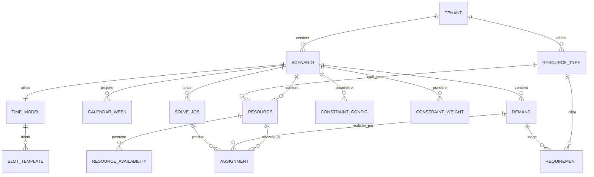

# SDD — Moteur de planification paramétrable

> **Statut** : spécification de conception, version 1.0
> **Périmètre** : backend uniquement
> **Cible V1** : établissement scolaire · **Cibles ultérieures** : entreprise, restauration

---

## 0. Comment lire ce document

Ce document est la référence de conception du backend. Il fixe le vocabulaire, les
décisions structurantes et les invariants. Il est destiné à être lu par les
développeurs humains **et** par les agents chargés de générer du code.

Trois conventions de lecture :

| Marqueur | Signification |
|---|---|
| **DÉCISION** | Choix arrêté, à ne pas rediscuter sans révision du document |
| **INVARIANT** | Propriété qui doit toujours être vraie, à faire respecter par du code |
| **PIÈGE** | Erreur constatée ou anticipée, avec sa parade |

### Avertissement sur les API externes

Les signatures Timefold citées ici correspondent à la branche 2.x. L'API évolue
(certains noms ont changé récemment, par exemple `nullable` devenu
`allowsUnassigned`). **Avant toute implémentation, vérifier la signature exacte
contre la version verrouillée dans le `pom.xml`.** Ce document décrit des
intentions de conception, pas une documentation d'API.

---

## 1. Besoin métier

### 1.1 Le problème

Produire automatiquement un planning qui affecte, à chaque activité à réaliser,
un créneau horaire et l'ensemble des ressources dont elle a besoin, en respectant
un jeu de règles configurable.

Ce n'est pas une application CRUD. C'est un **problème d'optimisation sous
contraintes**, NP-difficile, dont la résolution automatique constitue l'essentiel
de la valeur et de la difficulté du produit.

### 1.2 Cas d'usage V1 — établissement scolaire

Les besoins exprimés :

- Les **enseignants** ont un volume horaire et des niveaux de classe qu'ils
  peuvent prendre en charge.
- Les **salles** ont des disponibilités fixes et une capacité maximale.
- Les **groupes d'élèves** ont un effectif et un programme à couvrir.
- Chaque enseignant a ses propres disponibilités, qui diffèrent d'une personne à
  l'autre (exemple de référence : *Jean n'est disponible que le mardi et le
  mercredi*).

### 1.3 Cas d'usage ultérieurs

| Verticale | Ressources typiques | Spécificités |
|---|---|---|
| Entreprise | employés, postes, véhicules, matériel | congés individuels datés, équité sur la durée, repos minimum |
| Restauration | personnel de salle, cuisine, postes | couverture par tranche horaire, pics d'affluence, rotations |

Ces verticales partagent le moteur mais changent **le modèle temporel**, **les
types de ressources** et **le catalogue de règles actives**. Elles ne changent
pas le noyau.

### 1.4 Exigence transverse

Le produit doit être **paramétrable sans redéploiement** pour l'essentiel des
besoins, et extensible par ajout de code pour le reste. Cette exigence pilote
toute la conception : elle interdit de coder en dur les notions
« professeur », « salle » ou « classe » dans le noyau.

---

## 2. Principes directeurs

### 2.1 Le vocabulaire est en code, les phrases sont en base

**DÉCISION.** Le code fournit un langage : des types de contraintes, des
opérateurs de critères, des stratégies de placement. La base contient les phrases
écrites avec ce langage par chaque client.

```
Code   →  "load.max", "contains", "gte", "window"        ← les mots
Base   →  "enseignants : max 6h par jour"                ← les phrases
```

La richesse du vocabulaire initial détermine combien de temps un nouveau besoin
reste de la simple configuration. Un vocabulaire pauvre ramène en Java à chaque
nouveau client.

### 2.2 Le solveur ne comprend rien

**INVARIANT.** Timefold ne connaît ni enseignant, ni salle, ni manager. Il ne
sait faire que trois choses :

1. lire une liste de cases à remplir (les variables de planification) ;
2. pour chaque case, piocher dans une liste de valeurs candidates ;
3. noter le résultat via une fonction de score.

Toute sémantique métier vit dans le *builder* (qui prépare les données) et dans
les *plugins* (qui notent). Aucune donnée n'a d'effet par elle-même : **une
donnée n'existe pour le solveur que par la contrainte qui la consulte.**

Corollaire pratique : un `BitSet` de disponibilités sans plugin pour le lire ne
produit strictement rien. Le catalogue de plugins détermine la valeur du produit,
pas la richesse des données.

### 2.3 Ce qui ne varie pas pendant la résolution se compile

**DÉCISION.** Chaque donnée existe sous deux formes : une forme lisible et
éditable en base, une forme optimisée en mémoire. Le builder fait la traduction
une fois par résolution.

| En base — lisible, éditable | En mémoire — rapide à lire |
|---|---|
| `resource_availability` (lignes de règles) | `BitSet` porté par la ressource |
| `requirement.criteria` (JSON) | liste `eligible` portée par le booking |
| `demand.duration_minutes` (minutes) | nombre de créneaux |
| `demand` + `requirement` | entités de planification |

**Exception unique** : `constraint_config` ne se compile pas. Ses lignes restent
des faits vivants pendant toute la résolution, parce que les contraintes doivent
les joindre dynamiquement avec des affectations qui, elles, changent en
permanence.

Le critère de décision : *est-ce que ça dépend d'une variable de planification ?*
Si non, compiler. Si oui, laisser interrogeable en direct.

### 2.4 Impossible structurel → vivier · Règle d'organisation → contrainte

**DÉCISION.** C'est la frontière la plus lourde de conséquences du projet.

| | Vivier (`@ValueRangeProvider`) | Contrainte (plugin) |
|---|---|---|
| Contient | ce qui est structurellement impossible | toute règle d'organisation |
| Effet | la valeur n'est jamais proposée | la valeur est proposée puis pénalisée |
| Coût | réduit l'espace de recherche | évalué en boucle chaude |
| Explicabilité | **aucune** — exclusion muette | apparaît dans le rapport de score |
| Modifiable | par redéploiement ou rechargement | par configuration |

Le test : **quelqu'un pourrait-il un jour vouloir l'enfreindre ?**

- *Un professeur d'histoire ne peut pas enseigner les mathématiques* → vivier.
- *Les mathématiques plutôt le matin* → contrainte souple.
- *Jean n'est pas disponible le lundi* → contrainte, même si elle est bloquante
  aujourd'hui. Le proviseur peut demander une exception demain.

**PIÈGE.** Une exclusion par vivier est définitive et silencieuse. Si aucun
candidat ne subsiste, le solveur échoue à l'initialisation sans jamais dire
pourquoi. D'où l'obligation de valider tous les viviers avant l'appel à `solve()`
(voir §15).

### 2.5 La correction migre du compilateur vers le chargeur

**INVARIANT — le risque central du projet.**

Dans un modèle typé en dur, beaucoup d'erreurs sont impossibles à écrire. Dans un
modèle générique piloté par la donnée, elles deviennent possibles **et
silencieuses** : un vivier mal filtré, un `BitSet` mal compilé, une ligne de
configuration référençant un plugin inexistant.

Tout ce que le compilateur ne vérifie plus, le chargeur doit le vérifier —
**bruyamment**, avec un message métier exploitable. Un `throw` au chargement coûte
quelques microsecondes ; la même vérification en contrainte serait rejouée des
millions de fois pour ne rien détecter dans la quasi-totalité des cas.

### 2.6 La spécificité vient de la donnée, jamais de la contrainte

**INVARIANT.** Il n'existe pas de contrainte « Jean n'est pas là le lundi ». Il
existe une contrainte `resource.availability` qui s'applique aux 500 ressources,
et un `BitSet` propre à Jean qui la fait se déclencher pour lui.

Corollaire : il n'existe **aucune taxonomie** de contraintes du type
« générales » contre « par ressource ». Tous les plugins implémentent la même
interface et vivent dans le même registre. Ce qui varie est uniquement *où chaque
plugin va lire ses paramètres* — attributs de ressource, lignes de
`constraint_config`, ou les deux. C'est un détail d'implémentation interne à
chaque classe.

**Ne pas créer deux interfaces ni deux registres sur cette base.** De nombreux
plugins lisent les deux sources et ne rentreraient dans aucune case.
---

## 3. Décisions techniques

### ADR-001 — Stack

**DÉCISION.** Java 21 + Spring Boot 3 + Timefold Solver + PostgreSQL.

Justification : le choix du moteur de résolution détermine le langage, pas
l'inverse. Timefold est natif JVM, et son mode de fonctionnement — calcul de
score incrémental, boucle CPU de plusieurs millions d'itérations par minute —
correspond exactement au régime où le JIT de la JVM excelle.

Timefold 2.x exige Java 21 au build et au runtime.

Alternatives écartées :

| Option | Raison du rejet |
|---|---|
| OR-Tools CP-SAT | Modélisation bas niveau ; le modèle doit être reconstruit intégralement à chaque résolution, ce qui s'accorde mal avec des contraintes activables et repondérables à chaud |
| Solveur maison | Coût sans commune mesure avec le bénéfice |
| Python / TypeScript | Deux écosystèmes à maintenir, contrat de sérialisation problème/solution à gérer |

### ADR-002 — Édition Timefold

**DÉCISION.** Démarrer en **Community Edition** (Apache 2.0, usage commercial
autorisé, aucune restriction intégrée).

L'édition Enterprise, propriétaire, ajoute : Score Analysis, Recommendation API,
solving multithreadé, nearby selection, partitioned search, constraint profiling,
multistage moves.

**Ce choix est définitif.** Aucune fonctionnalité du produit ne doit dépendre
d'une édition payante, y compris pour les jalons ultérieurs.

Trois absences à assumer, et leurs parades :

| Absence en Community 2.x | Parade | Périmètre |
|---|---|---|
| Multithread par résolution | Scaling horizontal : N résolutions en parallèle, une par worker. C'est de toute façon le bon axe pour un SaaS multi-tenant | ADR-004 |
| **Toute explicabilité** — `ScoreExplanation` supprimé en 2.0, `ScoreAnalysis` réservé aux éditions Plus et Enterprise | Couche construite en interne, **obligatoire en V1** | ADR-003, §16 |
| Nearby selection, partitioned search | Non nécessaires à la taille de problème visée. À réévaluer sur mesures réelles | §8.8 |

**PIÈGE — ne pas rester sur Timefold 1.x pour conserver l'explicabilité
gratuite.** En 1.x, `getConstraintMatchTotalMap()` et `getIndictmentMap()` étaient
disponibles en Community. La tentation de figer la version est réelle, et c'est
un mauvais calcul : cette branche ne recevra plus de correctifs.

### ADR-003 — Explicabilité construite en interne, obligatoire en V1

**Ce n'est pas un choix de qualité, c'est le seul chemin disponible.** En
Community 2.x, aucune API ne permet de savoir quelle contrainte a été violée par
quelle ressource.

**DÉCISION.** Chaque plugin expose **deux** implémentations de sa règle :

```java
public interface ConstraintPlugin {
    /** Pour le solveur : Constraint Streams, calcul incrémental. */
    Constraint build(ConstraintFactory factory);

    /** Pour l'API : Java simple, sur une solution figée. Voir §16. */
    List<Violation> validate(Schedule solution, ConstraintConfig config);
}
```

**Cette couche est dans le périmètre V1.** Sans elle, un planning invalide se
présente comme un écran vide sans explication, ce qui rend le produit
inexploitable en conditions réelles.

Coût : une duplication de la logique, dont la dérive est le risque principal.
**Un test de cohérence obligatoire** vérifie que la somme des violations
rapportées redonne exactement le score du solveur (§16.5). Un plugin sans ce test
n'est pas terminé.

Bénéfice au passage : les messages produits sont dans le vocabulaire du métier,
ce qu'aucune API générique ne saurait faire.

### ADR-004 — Le solveur hors du cycle HTTP

**DÉCISION.** Une résolution prend de quelques secondes à plusieurs minutes.
Elle ne s'exécute jamais dans une requête HTTP.

```
API  →  crée un solve_job (statut QUEUED)  →  répond 202 + id du job
        ↓
Worker  →  consomme le job  →  résout  →  écrit les assignments  →  statut DONE
        ↓
API  →  SSE ou polling pour la progression et la meilleure solution courante
```

Les workers sont CPU-bound, sans état, et scalent horizontalement.

### ADR-005 — Type de score

**DÉCISION V1.** `HardSoftScore`, comparé lexicographiquement : le niveau dur
domine, le souple ne départage qu'à égalité de dur.

```
-1 hard / -10 soft   est PIRE que   0 hard / -99999 soft
```

Aucune quantité de confort ne compense une contrainte dure violée. C'est le
comportement voulu : un planning où Jean travaille un lundi n'est pas « un peu
moins bon », il est invalide.

**Point de vigilance.** Si le calibrage des poids entre contraintes souples
devient difficile — typiquement lorsqu'on souhaite qu'une obligation
contractuelle domine intégralement un confort, sans jouer sur des rapports de
1 à 1000 —, c'est le signal qu'il faut passer à `BendableScore` (N niveaux durs,
M niveaux souples hiérarchisés).

**Changer de type de score implique de reprendre toutes les contraintes.**
Trancher tôt, pendant les premiers essais sur données réelles.

### ADR-006 — Horizon temporel par profil métier

**DÉCISION.** Deux modes, choisis par le profil :

| | `Cyclic` | `Dated` |
|---|---|---|
| Cible | scolaire | entreprise, restauration |
| Créneaux | position dans un cycle de N jours | dates réelles sur un horizon glissant |
| Absences | collectives, alignées sur le cycle | individuelles, datées |
| Régularité | acquise par construction | à contraindre explicitement |
| Taille typique | 600 séances | 2 000 à 5 000 affectations |

Le mécanisme intermédiaire de « profils de semaine » a été **explicitement
écarté** : il faisait mal ce que l'allongement du cycle fait bien. Un RTT régulier
(*un vendredi sur deux*) s'exprime par `cycle_days = 14`. Un RTT posé au choix de
chacun exige des dates. Rien ne tombe entre les deux.

**V1 implémente uniquement `Cyclic`**, mais l'interface `TimeHorizon` existe dès
le premier jour avec cette seule branche (voir §14).

Limite acceptée en mode cyclique : un jour férié en milieu de semaine est
inexprimable. Les heures sont perdues ou rattrapées hors moteur, comme dans tous
les logiciels du marché. La couche de publication marque simplement la journée
comme non travaillée.

### ADR-007 — Le mode daté n'est pas « pour plus tard »

Le module de **remplacement** — *Jean est absent jeudi, qui prend ses cours ?* —
est une résolution datée sur une fenêtre courte, tout épinglé sauf les séances
touchées. C'est la deuxième fonctionnalité que tout établissement demandera.

`Dated` est donc la V2 du produit scolaire, qui se trouve aussi ouvrir la
verticale entreprise. Le retour sur investissement est bien supérieur à celui
d'un mécanisme intermédiaire.

---

## 4. Architecture applicative

### 4.1 Découpage en trois couches

```
┌──────────────────────────────────────────────────────────────┐
│  API                                                          │
│  Contrôleurs REST · DTO · validation de surface · sécurité   │
│  Ne connaît ni Hibernate ni Timefold                         │
├──────────────────────────────────────────────────────────────┤
│  DOMAIN                                                       │
│  Services · objets domaine immuables · plugins · builder     │
│  Ne connaît ni HTTP ni JPA                                   │
├──────────────────────────────────────────────────────────────┤
│  REPOSITORY                                                   │
│  Interfaces Spring Data · entités Hibernate · requêtes       │
│  Ne connaît ni DTO ni Timefold                               │
└──────────────────────────────────────────────────────────────┘
```

Chaque frontière est franchie par un **mapper explicite**. Aucun objet ne
traverse deux couches.

### 4.2 Arborescence

```
src/main/java/com/planning/
├── api/
│   ├── controller/         ResourceController, DemandController,
│   │                       ConstraintController, SolveController
│   ├── dto/                ResourceDto, DemandDto, SolveRequestDto…
│   ├── mapper/             ResourceApiMapper…        (DTO ↔ domaine)
│   └── advice/             GlobalExceptionHandler
│
├── domain/
│   ├── model/              Resource, TimeProfile, Timeslot,
│   │                       ScheduledActivity, ResourceBooking, Schedule
│   ├── criteria/           Criterion + opérateurs, CriterionParser
│   ├── time/               TimeHorizon, TimeGrid, GapPolicy, Period
│   ├── placement/          PlacementStrategy + implémentations
│   ├── constraint/         ConstraintPlugin, ConstraintRegistry,
│   │   └── plugin/         GenericConstraintProvider, les 12 plugins V1
│   ├── builder/            ProblemBuilder, AvailabilityCompiler,
│   │                       EligibilityResolver, ProblemValidator
│   ├── solver/             SolverService, SolveJobRunner
│   └── service/            ResourceService, DemandService…
│
├── repository/
│   ├── entity/             ResourceEntity, DemandEntity…  (@Entity JPA)
│   ├── jpa/                ResourceJpaRepository…         (Spring Data)
│   └── mapper/             ResourcePersistenceMapper…     (entité ↔ domaine)
│
└── config/                 SolverConfig, JacksonConfig, SecurityConfig
```

### 4.3 Règles de dépendance

**INVARIANT.** Les dépendances ne vont que vers l'intérieur.

| Couche | Peut dépendre de | Ne doit jamais dépendre de |
|---|---|---|
| `api` | `domain` | `repository`, Hibernate, Timefold |
| `domain` | rien du projet | `api`, `repository`, JPA, HTTP |
| `repository` | `domain` (pour les mappers) | `api`, Timefold |

Le domaine définit les interfaces de dépôt dont il a besoin ; la couche
`repository` les implémente. C'est l'inversion de dépendance classique, et c'est
ce qui rend le `ProblemBuilder` testable sans base de données.

### 4.4 PIÈGE — les entités JPA ne vont jamais dans le solveur

**INVARIANT.** Le `ProblemBuilder` reçoit des objets domaine, jamais des entités
Hibernate.

Deux raisons, toutes deux graves :

1. **Chargement paresseux.** Une relation `LAZY` touchée pendant la résolution
   déclenche une requête SQL au milieu de la boucle chaude, ou une
   `LazyInitializationException` hors transaction.
2. **Mutabilité.** Les entités JPA sont mutables et suivies par le contexte de
   persistance. Or Timefold partage les faits du problème par référence entre
   tous les clones de solution. Une mutation corrompt silencieusement toutes les
   photos déjà prises, dont la meilleure solution.

Les mappers de persistance produisent des `record` immuables. Cette conversion
n'est pas une formalité, c'est une barrière de sécurité.

### 4.5 Multi-tenant

**DÉCISION.** `tenant_id` sur toutes les tables métier, filtré systématiquement.
Un `scenario_id` isole en plus chaque instance de planification à l'intérieur
d'un tenant, ce qui permet de comparer plusieurs plannings candidats.

Toutes les configurations — poids, catalogue actif, modèle temporel — sont
portées par le scénario. Deux établissements du même déploiement peuvent donc
avoir des arbitrages opposés.
---

## 5. Modèle conceptuel de données

### 5.1 Vue d'ensemble



### 5.2 Les quatre familles

| Famille | Tables | Rôle |
|---|---|---|
| **Référentiel** | `resource_type`, `resource`, `resource_availability` | Ce qui existe et quand c'est disponible |
| **Demande** | `demand`, `requirement` | Ce qu'il faut planifier |
| **Règles** | `constraint_config`, `constraint_weight` | Comment juger un planning |
| **Temps** | `time_model`, `slot_template`, `calendar_week` | Comment le temps est découpé |

Le résultat (`solve_job`, `assignment`) constitue une cinquième famille, en
écriture seule depuis les workers.

### 5.3 INVARIANT — aucun index de créneau en base

**Les créneaux sont une notion dérivée, calculée en mémoire.** La base ne stocke
que des durées en minutes et des heures réelles.

Motif : la grille est un paramètre modifiable. Stocker `duration_slots = 3`
signifie « 90 minutes » sur une grille de 30 minutes et « 45 minutes » sur une
grille de 15. Un changement de granularité corromprait silencieusement toutes les
données existantes.

| Interdit en base | Correct en base |
|---|---|
| `duration_slots` | `duration_minutes` |
| `start_slot` | `start_time` |
| `placement.startSlot` | `placement.startTime` |

La conversion se fait au chargement, avec contrôle de compatibilité (§10.4).

---

## 6. Dictionnaire des tables

### 6.1 `tenant`

Client du SaaS.

| Colonne | Type | Description |
|---|---|---|
| `id` | uuid PK | |
| `code` | text UNIQUE | Identifiant lisible |
| `label` | text | Raison sociale |
| `profile` | text | `SCHOOL`, `COMPANY`, `RESTAURANT` — détermine le catalogue proposé et le mode d'horizon par défaut |
| `created_at` | timestamptz | |

### 6.2 `scenario`

Instance de planification. Permet de comparer plusieurs plannings candidats et
d'archiver les versions publiées.

| Colonne | Type | Description |
|---|---|---|
| `id` | uuid PK | |
| `tenant_id` | uuid FK | |
| `label` | text | « Rentrée 2026 », « Variante sans le vendredi après-midi » |
| `time_model_id` | uuid FK | Le modèle temporel de ce scénario |
| `status` | text | `DRAFT`, `SOLVING`, `SOLVED`, `PUBLISHED`, `ARCHIVED` |
| `parent_id` | uuid FK NULL | Scénario dont celui-ci est dérivé |
| `created_at` | timestamptz | |

**INVARIANT.** Un scénario `PUBLISHED` est figé. Modifier le modèle temporel ou
la granularité impose de créer un nouveau scénario. Les anciens plannings restent
lisibles dans leur propre grille.

### 6.3 `resource_type`

Catégorie de ressource, avec le schéma de ses attributs. C'est le pivot de
l'extension à de nouvelles verticales.

| Colonne | Type | Description |
|---|---|---|
| `id` | uuid PK | |
| `tenant_id` | uuid FK | |
| `code` | text | `enseignant`, `salle`, `groupe`, `employe`, `poste` |
| `label` | text | Libellé affiché |
| `attr_schema` | jsonb | JSON Schema des attributs autorisés pour ce type |
| | | UNIQUE (`tenant_id`, `code`) |

Rôles :

1. **Premier filtre d'éligibilité** — un besoin de salle ne regarde que les
   ressources de type salle.
2. **Contrat de données** — `attr_schema` valide les attributs à la saisie.
   Impossible d'enregistrer une salle avec `capacite: "beaucoup"`, donc les
   opérateurs `gte` ne planteront jamais sur une valeur aberrante.
3. **Générateur d'interface** — le formulaire de création se déduit du schéma.
4. **Pivot du profil métier** — ouvrir une verticale, c'est une série d'`INSERT`.

Exemple pour le profil scolaire :

| `code` | attributs déclarés |
|---|---|
| `enseignant` | `matieres[]`, `niveaux[]`, `statut`, `quota_hebdo_minutes` |
| `salle` | `capacite`, `usages[]`, `batiment`, `equipements[]` |
| `groupe` | `effectif`, `niveau`, `options[]` |

### 6.4 `resource`

Une ressource planifiable.

| Colonne | Type | Description |
|---|---|---|
| `id` | uuid PK | |
| `scenario_id` | uuid FK | |
| `type_id` | uuid FK | → `resource_type` |
| `label` | text | « Jean Dupont », « Salle B12 » |
| `default_effect` | text | `AVAILABLE` ou `UNAVAILABLE` — la posture par défaut |
| `attributes` | jsonb | Attributs métier, validés contre `attr_schema` |

**Pourquoi `default_effect`.** Les ressources réelles se répartissent en deux
archétypes opposés :

- *indisponible sauf…* — Jean, vacataire, deux jours par semaine. Défaut
  `UNAVAILABLE` + 2 règles d'ouverture.
- *disponible sauf…* — la salle B12, ouverte toute la semaine sauf le vendredi
  après-midi. Défaut `AVAILABLE` + 1 règle de fermeture.

Sans ce défaut, décrire la salle B12 exigerait de saisir tous ses créneaux
d'ouverture un par un.

**INVARIANT.** Le `code` du type doit être recopié dans `attributes` sous la clé
`type` au chargement. Le moteur de critères ne lit que `attributes` : sans cette
projection, un scope `{"eq":{"path":"/type","value":"enseignant"}}` ne matcherait
jamais rien — silencieusement.

### 6.5 `resource_availability`

Les règles de disponibilité d'une ressource, exprimées comme un motif récurrent
sur le cycle. Compilées en `BitSet` au chargement.

| Colonne | Type | Description |
|---|---|---|
| `id` | uuid PK | |
| `resource_id` | uuid FK | ON DELETE CASCADE |
| `effect` | text | `AVAILABLE`, `UNAVAILABLE`, `DISCOURAGED` |
| `day_in_cycle` | int NULL | 0 … `cycle_days - 1`. NULL = tous les jours |
| `start_time` | time NULL | NULL = à partir de l'ouverture |
| `end_time` | time NULL | NULL = jusqu'à la fermeture |
| `priority` | int NOT NULL DEFAULT 0 | Ordre d'application, croissant |

Une colonne à `NULL` signifie « pas de restriction sur cet axe ».

**Pourquoi `day_in_cycle` et non `day_of_week`.** Avec `cycle_days = 14`, la
notion de jour de la semaine est ambiguë : le mardi de la semaine A et celui de
la semaine B sont deux positions distinctes. L'index dans le cycle lève
l'ambiguïté et fonctionne pour toute longueur de cycle.

**Pourquoi pas de `valid_from` / `valid_to`.** Ces colonnes ont été retirées :
elles décrivent un axe temporel daté que le mode `Cyclic` ne voit pas. Les
exceptions datées relèvent du mode `Dated` et du module de remplacement.

**Résolution des conflits** — deux règles couvrant le même créneau :

1. `priority` croissante, la dernière appliquée gagne ;
2. à priorité égale, `UNAVAILABLE` l'emporte — en cas de doute, on ne planifie
   pas.

**PIÈGE — inclusion contre chevauchement.** Le test de couverture d'un créneau
n'est pas symétrique :

- pour `UNAVAILABLE`, un **chevauchement** suffit — un créneau à moitié couvert
  par une fermeture doit être fermé ;
- pour `AVAILABLE`, il faut une **inclusion complète** — un créneau à moitié
  couvert par une ouverture serait sinon considéré comme entièrement disponible
  alors que la ressource n'est là que la moitié du temps.

### 6.6 `time_model`

Le découpage temporel du scénario.

| Colonne | Type | Description |
|---|---|---|
| `id` | uuid PK | |
| `tenant_id` | uuid FK | |
| `label` | text | |
| `horizon_kind` | text | `CYCLIC` ou `DATED` |
| `cycle_days` | int NULL | Requis si `CYCLIC`. 7, 10, 14, 28… |
| `horizon_from` | date NULL | Requis si `DATED` |
| `horizon_to` | date NULL | Requis si `DATED` |
| `max_gap_minutes` | int NOT NULL DEFAULT 0 | Politique de coupure (§12.3) |

**Compter en jours, pas en semaines.** `cycle_days` autorise les rotations qui ne
tombent pas juste sur des semaines — décadaires en milieu hospitalier, cycles de
10 ou 21 jours en industrie. Le profil scolaire impose simplement un multiple
de 7.

| Besoin | `cycle_days` | Créneaux (5 j, 8h–19h, pas de 60 min) |
|---|---|---|
| Semaine simple | 7 | 55 |
| Quinzaine paire/impaire | 14 | 110 |
| Rotation sur 4 semaines | 28 | 220 |

### 6.7 `slot_template`

La grille des créneaux, **stockée et non calculée**.

| Colonne | Type | Description |
|---|---|---|
| `id` | uuid PK | |
| `time_model_id` | uuid FK | |
| `day_in_cycle` | int | 0 … `cycle_days - 1` |
| `ordinal` | int | Position du créneau dans sa journée, 0-indexée |
| `start_time` | time | |
| `end_time` | time | |
| | | UNIQUE (`time_model_id`, `day_in_cycle`, `ordinal`) |

**DÉCISION — stocker plutôt que calculer.** Les établissements réels ont des
séquences irrégulières : cours de 55 minutes, récréation de 15, pause déjeuner de
1 h 45, journée raccourcie le mercredi. Une grille calculée par pas constant ne
peut pas les décrire, et la limite se découvre chez le premier client sérieux.

Une table explicite couvre les deux cas — un générateur remplit la grille
régulière en trois lignes quand elle suffit — et supprime au passage le paramètre
`slot_minutes`, qui n'était qu'une hypothèse déguisée.

**`ordinal` — à quoi il sert.** C'est la numérotation que l'établissement utilise
lui-même : « 1ʳᵉ heure », « 2ᵉ heure ». Il est **relatif à la journée**, à ne pas
confondre avec l'`index` global du `Timeslot` qui sert à lire les `BitSet`. Le
premier cours du lundi et celui du jeudi ont tous deux `ordinal = 0`, alors que
leurs index diffèrent.

Il rend exprimables toutes les règles qui parlent de la journée plutôt que de
l'horloge : « pas de cours en dernière heure pour les 6ᵉ », « éviter la première
heure », la détection de trous. Il est aussi indispensable à l'affichage.

**PIÈGE.** Deux ordinaux successifs ne sont pas nécessairement contigus dans le
temps — une récréation ou une pause déjeuner peut les séparer. Toute règle
parlant de séances « consécutives » doit tester la contiguïté réelle
(`a.end().equals(b.start())`), jamais `ordinal + 1`. La version naïve produit des
résultats faux uniquement autour des pauses : un bug rare, plausible et pénible à
reproduire.

### 6.8 `calendar_week`

Projection du cycle sur le calendrier réel. **Ne participe pas à la résolution** —
le solveur ne voit jamais cette table. Elle est consommée par le module de
publication.

| Colonne | Type | Description |
|---|---|---|
| `scenario_id` | uuid PK(1) | |
| `week_number` | int PK(2) | 1 … 52 |
| `worked` | boolean | `false` = vacances, la semaine n'est pas déroulée |
| `cycle_offset` | int NOT NULL DEFAULT 0 | Position dans le cycle, pour un cycle > 7 jours |

Les vacances scolaires y sont de simples semaines à `worked = false`. Elles
disparaissent du planning au lieu de le contraindre — plus juste et gratuit.

### 6.9 `demand`

Ce qu'il faut planifier. Un patron, pas encore une activité.

| Colonne | Type | Description |
|---|---|---|
| `id` | uuid PK | |
| `scenario_id` | uuid FK | |
| `label` | text | « Maths 6e A », « Couverture service matin » |
| `duration_minutes` | int NOT NULL | Durée d'**une** occurrence |
| `occurrences` | int NOT NULL | Combien de fois par cycle |
| `attributes` | jsonb | Métadonnées métier lues par les `scope` de contraintes : `matiere`, `niveau` |
| `placement` | jsonb | Instructions de placement temporel pour le builder |

**Pourquoi `attributes` et `placement` séparés.** Leurs consommateurs diffèrent :
`attributes` est lu par les scopes de contraintes, `placement` par le builder. Les
mélanger exposerait à un scope qui matcherait accidentellement sur une clé de
placement.

Contenu de `placement` :

```json
{ "strategy": "free" }
{ "strategy": "fixed",  "startTime": "07:00", "dayInCycle": 0 }
{ "strategy": "window", "from": "06:00", "to": "09:00" }
```

### 6.10 `requirement`

Un poste à pourvoir sur la demande.

| Colonne | Type | Description |
|---|---|---|
| `id` | uuid PK | |
| `demand_id` | uuid FK | ON DELETE CASCADE |
| `role` | text | Fonction occupée : `enseignant`, `salle`, `groupe`, `surveillant` |
| `type_id` | uuid FK | → `resource_type`, la catégorie acceptée |
| `quantity` | int NOT NULL DEFAULT 1 | Nombre de postes identiques |
| `criteria` | jsonb | Critères d'éligibilité, évalués par le moteur de critères |

**INVARIANT — rôle ≠ type.** Le **type** dit ce qu'est la ressource, le **rôle**
dit quelle fonction elle occupe. Ils coïncident souvent, mais pas toujours : un
examen a besoin de deux surveillants, et un surveillant peut être un enseignant
*ou* un membre du personnel administratif.

Le rôle sert aussi aux contraintes : `resource.consistency` — « le même
enseignant sur toutes les séances d'un cours » — raisonne sur le rôle, pas sur le
type. **Garder les deux champs distincts même quand ils se ressemblent** : les
fusionner est tentant et coûteux à défaire.

**Le `quantity` est le mécanisme du niveau 0.** « Il faut 6 personnes dont un
manager » se traduit par deux lignes : `role=manager, quantity=1` et
`role=agent, quantity=5`. Le builder boucle sur `quantity`, il ne sait pas qu'il
crée 6 bookings plutôt que 2.

### 6.11 `constraint_config`

Les règles configurées. **Ces lignes ne se compilent pas** : elles restent des
faits vivants pendant toute la résolution.

| Colonne | Type | Description |
|---|---|---|
| `id` | uuid PK | |
| `scenario_id` | uuid FK | |
| `type` | text | Identifiant du plugin : `load.max`, `gaps.avoid` |
| `scope` | jsonb | Critère désignant les ressources concernées. `{}` = toutes |
| `params` | jsonb | Réglages, dont la forme dépend du plugin |
| `weight` | int NOT NULL DEFAULT 1 | Poids ② — pondération de **cette** règle |
| `enabled` | boolean NOT NULL DEFAULT true | |

Exemple :

```sql
insert into constraint_config (scenario_id, type, scope, params, weight) values
 (:sc, 'load.max',
       '{"eq":{"path":"/type","value":"enseignant"}}',
       '{"maxMinutes":360,"period":"DAY"}', 1),
 (:sc, 'load.max',
       '{"eq":{"path":"/statut","value":"vacataire"}}',
       '{"maxMinutes":240,"period":"DAY"}', 3);
```

**Le cumul des scopes est une intersection de règles, pas une hiérarchie.** Jean,
enseignant vacataire, est soumis aux **deux** quotas simultanément. Pour qu'une
règle spécifique remplace la générale, l'exprimer dans le scope :

```json
{"and":[{"eq":{"path":"/type","value":"enseignant"}},
        {"not":{"eq":{"path":"/statut","value":"vacataire"}}}]}
```

C'est explicite, et préférable à un mécanisme de priorité implicite que personne
ne comprendrait en lisant la configuration.

### 6.12 `constraint_weight`

Le poids ① — l'arbitrage de politique entre types de contraintes.

| Colonne | Type | Description |
|---|---|---|
| `scenario_id` | uuid PK(1) | |
| `constraint_id` | text PK(2) | Identifiant du plugin |
| `level` | text | `HARD` ou `SOFT` — CHECK |
| `weight` | int | ≥ 0 — CHECK. `0` désactive la contrainte |

**Une contrainte est soit dure, soit souple — jamais les deux.** Le score étant
lexicographique, une pénalité comptée en dur rend la solution invalide, et les
points souples associés ne seraient jamais regardés. Un couple de colonnes
`hard_level`/`soft_level` serait une invitation à l'erreur ; le couple
`level` + `weight` rend l'exclusivité structurelle.

### 6.13 `solve_job`

| Colonne | Type | Description |
|---|---|---|
| `id` | uuid PK | |
| `scenario_id` | uuid FK | |
| `status` | text | `QUEUED`, `RUNNING`, `DONE`, `FAILED`, `CANCELLED` |
| `time_limit_seconds` | int | Budget de résolution |
| `hard_score` | int NULL | Score final |
| `soft_score` | int NULL | |
| `started_at`, `finished_at` | timestamptz NULL | |
| `error_code` | text NULL | `INFEASIBLE_EMPTY_POOL`, `INCOMPATIBLE_CONFIG`… |
| `error_detail` | text NULL | Message métier destiné à l'utilisateur |

### 6.14 `assignment`

Le résultat. **Une liste plate**, pas un planning par classe.

| Colonne | Type | Description |
|---|---|---|
| `id` | uuid PK | |
| `solve_job_id` | uuid FK | |
| `demand_id` | uuid FK | |
| `occurrence` | int | Numéro d'occurrence dans le cycle |
| `resource_id` | uuid FK NULL | NULL = poste non pourvu |
| `role` | text | |
| `day_in_cycle` | int | |
| `start_time` | time NOT NULL | Heure réelle, indépendante de toute grille |
| `end_time` | time NOT NULL | |
| `pinned` | boolean NOT NULL DEFAULT false | Verrouillé pour les re-résolutions |

**INVARIANT — stocker l'heure réelle, pas l'index de créneau.** Les exports iCal,
les affichages et les archives ne dépendent alors plus du modèle temporel du
moment.

**Il n'existe qu'un seul emploi du temps.** « L'emploi du temps de la 6e A »,
« celui de Jean », « l'occupation de la salle B12 » sont **trois filtres sur cette
table** :

```sql
select * from assignment where solve_job_id = :job and resource_id = :jean;
```

Rien n'entre en concurrence parce que rien n'est séparé. C'est une affaire de
projection côté API ; le solveur n'en sait rien et n'a pas à en savoir.
---

## 7. Modèle de domaine

Tous les objets de cette section sont des `record` **immuables**. C'est une
exigence de Timefold, pas une préférence de style : les faits du problème sont
partagés par référence entre tous les clones de solution (§8.4).

### 7.1 `Timeslot`

```java
public record Timeslot(
        int       index,        // 0 … n-1, position globale dans l'horizon
        int       dayInCycle,   // 0 … cycleDays-1
        int       ordinal,      // position dans la journée
        DayOfWeek weekday,      // dérivé, pour l'affichage
        LocalTime start,
        LocalTime end) {

    public int durationMinutes() {
        return (int) Duration.between(start, end).toMinutes();
    }
}
```

| Champ | Rôle |
|---|---|
| `index` | **Clé de tout le système.** C'est lui qui indexe les `BitSet`. Unique sur l'horizon complet |
| `dayInCycle` | Utilisé par les agrégations journalières et les contraintes d'étalement |
| `ordinal` | Position dans la journée. Permet « première heure », « dernière heure », détection de trous |
| `weekday` | Confort d'affichage. **Aucune contrainte ne doit en dépendre** — il n'existe pas en mode `Dated` sur un cycle non hebdomadaire |
| `start`, `end` | Heures réelles. Seule source de vérité pour la contiguïté |

**`Timeslot` est un objet du projet, pas de Timefold.** Timefold ne fournit
aucune classe métier — ni `Timeslot`, ni `Room`, ni `Employee`. La bibliothèque
contient uniquement des annotations, le moteur de recherche, l'API Constraint
Streams et les types de score. C'est ce qui la rend utilisable aussi bien pour des
emplois du temps que pour des tournées de camions : **elle n'a aucune notion de
temps**.

### 7.2 `Effect`

```java
public enum Effect {
    AVAILABLE  (true,  false),
    DISCOURAGED(true,  true),    // permis, mais pénalisé
    UNAVAILABLE(false, false);

    private final boolean allowed;
    private final boolean discouraged;

    Effect(boolean allowed, boolean discouraged) { … }

    public boolean allowed()     { return allowed; }
    public boolean discouraged() { return discouraged; }
}
```

**Cette table est l'invariant le plus fragile du système.** `DISCOURAGED` doit
mettre `allowed = true`, sinon un créneau découragé déclencherait aussi la
contrainte dure et deviendrait de fait interdit.

Le rendre déclaratif ici — plutôt que par un `if` enfoui dans une boucle de
compilation — permet de le lire en trois lignes et d'éviter qu'il ne soit
accidentellement inversé.

### 7.3 `TimeProfile`

```java
public record TimeProfile(BitSet allowed, BitSet discouraged) {

    public TimeProfile {
        BitSet orphans = (BitSet) discouraged.clone();
        orphans.andNot(allowed);
        if (!orphans.isEmpty())
            throw new IllegalStateException(
                "Créneaux découragés hors des créneaux permis : " + orphans);

        allowed     = (BitSet) allowed.clone();       // clonage défensif
        discouraged = (BitSet) discouraged.clone();
    }

    /** Toute la plage [from, toExclusive) est-elle permise ? */
    public boolean isAllowed(int from, int toExclusive) {
        return allowed.nextClearBit(from) >= toExclusive;
    }

    /** Au moins un créneau de la plage est-il découragé ? */
    public boolean isDiscouraged(int from, int toExclusive) {
        int next = discouraged.nextSetBit(from);
        return next >= 0 && next < toExclusive;
    }

    /** Nombre de créneaux interdits dans la plage — sert de poids ③. */
    public int forbiddenSlots(int from, int toExclusive) {
        BitSet window = allowed.get(from, toExclusive);
        return (toExclusive - from) - window.cardinality();
    }

    public static TimeProfile alwaysAvailable(int size) {
        BitSet all = new BitSet(size);
        all.set(0, size);
        return new TimeProfile(all, new BitSet(size));
    }
}
```

**Les deux `BitSet` ne sont pas deux niveaux d'un même axe.** `allowed` répond
« est-ce permis ? », `discouraged` répond « est-ce souhaitable ? ». Un créneau
découragé est permis **et** pénalisé.

**INVARIANT.** `discouraged ⊆ allowed`, vérifié dans le constructeur compact. Il
devient alors impossible de fabriquer un profil incohérent, même en modifiant le
compilateur.

**Nommer `allowed`, jamais `available`.** Le second se lit spontanément comme
« est-ce souhaitable ? », ce qui rend le code de la contrainte dure trompeur —
un lecteur conclut au bug en voyant `!isAvailable()` là où un créneau découragé
ne doit pas se déclencher.

**Clonage défensif.** `BitSet` est mutable, et c'est le seul champ mutable
subsistant dans les faits. Deux `clone()` au chargement suppriment définitivement
le risque de corruption des clones de solution.

**Aucune logique métier ici.** Pas de « est-ce le matin », pas de jour de la
semaine, pas de notion de cycle. `TimeProfile` ne connaît que des index ; tout le
reste appartient à `TimeHorizon`.

**Point d'extension.** Encapsuler les deux `BitSet` dans un record dédié plutôt
que de les poser directement sur `Resource` permet d'ajouter un troisième niveau
— `preferred`, pour bonifier plutôt que pénaliser — sans toucher à `Resource`, au
builder ni aux contraintes existantes.

#### Pourquoi `BitSet` plutôt que `boolean[]`

| Critère | Gain |
|---|---|
| Compacité | 1 bit contre 1 octet. Sur un horizon daté d'un an : 250 Ko contre 2 Mo, et tout tient dans le cache CPU |
| Opérations sur mots machine | `nextClearBit` teste 64 bits en une instruction — pas de boucle |
| Opérations ensemblistes | `andNot`, `cardinality` rendent l'invariant et `forbiddenSlots` triviaux |

Sa seule faiblesse est la mutabilité, traitée par le clonage défensif.

### 7.4 `Resource`

```java
public record Resource(
        UUID        id,
        UUID        typeId,
        String      label,
        TimeProfile time,
        JsonNode    attributes) {}
```

| Champ | Rôle |
|---|---|
| `id` | Identité. Base de l'`equals` utilisé comme clé d'agrégation |
| `typeId` | Premier filtre d'éligibilité, dans le builder uniquement |
| `label` | Affichage et messages d'erreur |
| `time` | Disponibilités compilées, lues en boucle chaude |
| `attributes` | Attributs métier, lus par les critères au chargement |

**Cinq champs, dont trois d'identité.** C'est volontaire : la classe générique
reste minuscule, toute la richesse métier vit dans `attributes`.

#### Règle d'arbitrage — champ fixe ou `attributes` ?

Le critère n'est pas « est-ce que tous les types s'en servent », mais :

> **Le moteur lit-il ce champ dans la boucle chaude, ou seulement le builder au
> chargement ?**

| | Champ fixe | `attributes` (jsonb) |
|---|---|---|
| Lu par | le moteur, en boucle chaude | les critères et scopes, une fois |
| Fréquence | millions par seconde | une fois au chargement |
| Exemples | `id`, `typeId`, `time` | `matieres`, `capacite`, `usages`, `statut` |
| Sémantique connue du moteur | oui | jamais |

C'est une **ligne de performance**, pas une ligne conceptuelle. Mettre `capacite`
en champ fixe gaspillerait la généricité ; mettre la disponibilité en jsonb serait
une catastrophe de performance.

**Signal d'alerte.** Un champ qui ne concerne qu'une partie des types —
`capacite` pour les salles, `permis` pour les chauffeurs — appartient à
`attributes`. Le jour où `if (typeId == SALLE)` apparaît dans le moteur, la ligne
a été franchie.

### 7.5 `ScheduledActivity` — entité de planification

```java
@PlanningEntity
public class ScheduledActivity {

    private UUID     demandId;         // fait
    private int      occurrence;       // fait
    private int      durationSlots;    // fait, compilé depuis duration_minutes
    private JsonNode attributes;       // fait, recopié de la demande

    private List<Timeslot> validStarts; // vivier, précalculé

    @PlanningVariable(valueRangeProviderRefs = "startSlots")
    private Timeslot start;             // ← LA VARIABLE

    @PlanningPin
    private boolean pinned;             // verrouillage pour l'édition manuelle

    @ValueRangeProvider(id = "startSlots")
    public List<Timeslot> getStartSlots() { return validStarts; }

    public int startIndex() { return start.index(); }
    public int endIndex()   { return start.index() + durationSlots; }
}
```

Une séance qui cherche son créneau. **Une seule variable : le moment.**

### 7.6 `ResourceBooking` — entité de planification

```java
@PlanningEntity
public class ResourceBooking {

    private ScheduledActivity activity;  // lien FIXE, jamais une variable
    private String            role;      // fait

    private List<Resource> eligible;     // vivier, précalculé

    @PlanningVariable(valueRangeProviderRefs = "eligible", allowsUnassigned = true)
    private Resource resource;           // ← LA VARIABLE

    @ValueRangeProvider(id = "eligible")
    public List<Resource> getEligible() { return eligible; }

    public int startIndex()      { return activity.startIndex(); }
    public int endIndex()        { return activity.endIndex(); }
    public int durationMinutes() { return activity.durationMinutes(); }
}
```

Un poste à pourvoir. **Une seule variable : la ressource.**

`allowsUnassigned` (anciennement `nullable`) permet un planning partiel plutôt
qu'un échec : si les 6 postes ne peuvent pas être pourvus, on obtient « 5 sur 6 »
au lieu d'« infaisable ». Une contrainte dédiée pénalise les postes vides
(§12.3). **Vérifier le nom exact de l'attribut contre la version utilisée.**

#### Pourquoi deux entités et non une seule classe à N variables

Une `@PlanningEntity` peut porter autant de `@PlanningVariable` que voulu — le
quickstart officiel de timetabling scolaire de Timefold utilise d'ailleurs une
classe unique avec `timeslot`, `room` et `teacher`.

La limite n'est pas dans Timefold, elle est dans **Java** : une classe a un
nombre de champs figé à la compilation. Or les besoins varient :

```
Cours magistral     → 1 enseignant, 1 salle
TP dédoublé         → 2 enseignants, 2 salles, 2 demi-groupes
Examen              → 2 surveillants, 1 salle, du matériel
Couverture 7h–15h   → 1 manager, 5 agents
```

Une classe unique porterait l'union de tous les cas, la plupart des champs à
`null`, et chaque nouveau rôle exigerait un redéploiement. `ResourceBooking`
transforme **un nombre variable de champs en un nombre variable d'objets**.

| | Une entité, N variables | Entité + bookings |
|---|---|---|
| Nombre de ressources | figé à la compilation | libre, piloté par la donnée |
| Nouveau rôle | champ + redéploiement | un `INSERT` |
| Mouvements composés | naturels | à configurer |
| Convient à | un métier connu | un produit paramétrable |

**Contrepartie assumée : le couplage des variables** (§8.8).

### 7.7 `ConstraintConfig` — domaine

```java
public record ConstraintConfig(
        UUID      id,
        String    type,       // 'load.max'
        Criterion scope,      // désérialisé, pas du JSON brut
        Object    params,     // record typé, désérialisé par le plugin
        int       weight,     // poids ②
        boolean   enabled) {

    @Override public boolean equals(Object o) {
        return o instanceof ConstraintConfig c && c.id.equals(id);
    }
    @Override public int hashCode() { return id.hashCode(); }
}
```

**`equals` et `hashCode` sur l'`id` uniquement.** Cet objet sert de clé
d'agrégation dans les `groupBy`. Un `equals` de record par défaut comparerait le
`JsonNode` en profondeur à chaque hachage — inacceptable en boucle chaude.

**`params` est déjà typé.** Le builder l'a désérialisé une fois vers le record
déclaré par le plugin. Aucun parsing JSON ne descend dans la boucle chaude.

### 7.8 `Criterion` — moteur de critères

```java
public sealed interface Criterion {

    boolean test(JsonNode attributes);

    default boolean matches(Resource resource) {
        return test(resource.attributes());
    }

    record Eq(String path, JsonNode value)          implements Criterion { … }
    record Neq(String path, JsonNode value)         implements Criterion { … }
    record Gt(String path, BigDecimal value)        implements Criterion { … }
    record Gte(String path, BigDecimal value)       implements Criterion { … }
    record Lt(String path, BigDecimal value)        implements Criterion { … }
    record Lte(String path, BigDecimal value)       implements Criterion { … }
    record In(String path, List<JsonNode> values)   implements Criterion { … }
    record Contains(String path, String value)      implements Criterion { … }
    record ContainsAll(String path, List<String> v) implements Criterion { … }
    record And(List<Criterion> children)            implements Criterion { … }
    record Or(List<Criterion> children)             implements Criterion { … }
    record Not(Criterion child)                     implements Criterion { … }
    record Always()                                 implements Criterion {
        public boolean test(JsonNode a) { return true; }
    }
}
```

Le chemin utilise **JSON Pointer** (RFC 6901), la syntaxe attendue par
`JsonNode.at()` de Jackson :

```java
.at("/matieres")            // → ["maths","physique"]
.at("/adresse/batiment")    // → "A"        navigation en profondeur
.at("/matieres/0")          // → "maths"    index de tableau
```

**PIÈGE — `has()` ne fait pas ce qu'on croit.** `JsonNode.has(String)` teste la
présence d'une **clé d'objet**, pas d'un élément de tableau. Sur
`["maths","physique"]`, `has("maths")` renvoie systématiquement `false` — sans
lever d'exception. C'est un bug parfaitement silencieux. Utiliser l'opérateur
`Contains`, qui itère correctement.

**INVARIANT — un plugin ne contient jamais de valeur métier en dur.** Le mot
« maths » n'apparaît nulle part dans le code : il vit dans le `scope` d'une ligne
de configuration. Sinon on retombe dans une règle par établissement, écrite en
Java.

#### Un seul moteur, deux usages

| | `requirement.criteria` | `constraint_config.scope` |
|---|---|---|
| Question | quelles ressources peuvent occuper ce poste | à quelles ressources s'applique cette règle |
| Consommé par | le builder, pour bâtir `eligible` | une jointure faits-à-faits |
| Évalué | une fois au chargement | une fois à l'initialisation du réseau |

Les deux sont évalués une seule fois : la jointure entre deux faits immuables ne
change plus une fois établie.
---

## 8. Modèle Timefold

### 8.1 `Schedule` — la solution

```java
@PlanningSolution
public class Schedule {

    // ═══ FAITS : ce qui remplit, jamais modifié ═══
    @ProblemFactCollectionProperty
    private List<Timeslot> timeslots;

    @ProblemFactCollectionProperty
    private List<Resource> resources;          // les TimeProfile sont ici

    @ProblemFactCollectionProperty
    private List<ConstraintConfig> configs;

    // ═══ ENTITÉS : ce qui est rempli ═══
    @PlanningEntityCollectionProperty
    private List<ScheduledActivity> activities;

    @PlanningEntityCollectionProperty
    private List<ResourceBooking> bookings;

    // ═══ POIDS ① : chargés depuis constraint_weight ═══
    private ConstraintWeightOverrides<HardSoftScore> weights;

    // ═══ SORTIE ═══
    @PlanningScore
    private HardSoftScore score;

    // Hors modèle Timefold, transporté pour les plugins et le builder
    private transient TimeHorizon horizon;
}
```

**Une classe, deux états.** C'est le point qui déroute au premier abord :
`Schedule` décrit le problème *et* contient la solution. On en construit une
instance avec les variables à `null`, on la donne au solveur, il rend une
instance du même type avec ces variables remplies.

```java
Schedule problem = builder.build(scenarioId);
// problem.score == null, chaque start == null, chaque resource == null

Schedule solved = solver.solve(problem);
// solved.score == HardSoftScore.of(0, -290), tout est rempli
```

`solve()` rend **un autre objet**, pas celui qui a été passé.

### 8.2 Rôle de chaque annotation

| Annotation | Question à laquelle elle répond | Portée |
|---|---|---|
| `@ProblemFactCollectionProperty` | sur quels objets mes contraintes ont-elles le droit de raisonner ? | sur la solution |
| `@PlanningEntityCollectionProperty` | quels objets le solveur a-t-il le droit de muter ? | sur la solution |
| `@ValueRangeProvider` | dans quoi cette variable pioche-t-elle ? | **sur chaque entité** |
| `@PlanningVariable` | quel champ le solveur remplit-il ? | sur l'entité |
| `@PlanningScore` | où écrire le résultat de l'évaluation ? | sur la solution |

**INVARIANT — aucun `@ValueRangeProvider` sur `Schedule`.** Tous les viviers sont
par entité. `Schedule.timeslots` et `Schedule.resources` ne sont **pas** des
viviers : ce sont des données pour les contraintes.

### 8.3 Pourquoi conserver `resources` et `timeslots` sur la solution

Ces listes ne servent qu'aux contraintes — mais elles y sont indispensables. Un
`forEach(Resource.class)` échoue au démarrage sans la déclaration.

Le cas qui l'exige est celui des règles portant sur une **absence** :

```java
// ✗ Sophie n'a aucun booking → elle n'apparaît nulle part → déséquilibre invisible
factory.forEach(ResourceBooking.class)
       .groupBy(ResourceBooking::getResource, count())

// ✓ Sophie est dans la liste complète → sa charge nulle est constatée
factory.forEach(Resource.class)
       .filter(r -> r.attributes().at("/matieres").has("maths"))
       .join(ResourceBooking.class, equal(identity(), ResourceBooking::getResource))
```

Autres exemples : « chaque salle sert au moins une fois », « aucun enseignant sans
cours », « au moins une salle libre à chaque créneau ».

**Aucune duplication de données.** `Schedule.resources`, `booking.eligible` et
`booking.resource` pointent vers les **mêmes objets**. `eligible` est un
sous-ensemble par référence.

```
Les 500 objets Resource, créés une fois par le builder :

     Resource(Jean, TimeProfile(…), attributes)   Resource(B12, …)   …
              ▲                                          ▲
Schedule.resources ───────────────────────────────────── ┘   (les 500)
booking#12.eligible ─────────────────────────────────────┘   (7 salles)
booking#12.resource ─────────────────────────────────────┘   (celle affectée)
```

### 8.4 Le planning clone

Pendant la résolution, Timefold clone régulièrement la solution pour photographier
la meilleure trouvée. Ce clonage est **asymétrique** :

- les entités de planification sont copiées en profondeur ;
- **les faits du problème sont partagés par référence** entre tous les clones.

C'est ce qui rend l'opération assez rapide pour être faite en continu.

**INVARIANT — les faits sont strictement immuables.** Modifier un `Timeslot`, une
`Resource` ou un `BitSet` en cours de résolution corrompt simultanément toutes les
photos, y compris la meilleure solution. Le bug est silencieux et très difficile à
diagnostiquer. Les `record` et le clonage défensif de `TimeProfile` suppriment le
problème par construction.

### 8.5 Le score

`HardSoftScore` porte deux compteurs comparés lexicographiquement.

```
Jean sur un créneau découragé, 2 créneaux  →  30 × 2   =  -60 soft
Marie sur un créneau découragé, 1 créneau  →  30 × 1   =  -30 soft
Trou dans l'emploi du temps de la 2nde 3   → 200 × 1   = -200 soft
                                              ─────────────────────
                                              0 hard / -290 soft
```

C'est ce total unique qui produit les arbitrages : sortir Jean du jeudi ferait
gagner 60 points mais créerait un trou coûtant 200 — le solveur laissera donc Jean
en place. C'est exactement le comportement attendu d'une contrainte souple.

### 8.6 Comment le solveur travaille

**Phase 1 — construction.** Parcours glouton et déterministe : à chaque variable,
la valeur la moins mauvaise sur le moment, sans retour arrière. En une passe, tout
est rempli et généralement médiocre.

**Phase 2 — recherche locale.** Des dizaines de milliers d'itérations par seconde :

```
1. proposer un changement candidat   (booking #12 : salle 1 → salle 2)
2. l'appliquer
3. recalculer le score en incrémental
4. garder ou annuler
```

L'aléatoire intervient dans la **proposition**, jamais dans la **conservation** :
c'est le score qui tranche. La métaheuristique accepte parfois une dégradation
pour sortir d'une impasse, tout en conservant une photo de la meilleure solution
vue.

À l'étape 3, seules les contraintes impliquant l'objet modifié sont réévaluées —
les autres séances gardent leur score. C'est le calcul incrémental, et c'est ce
qui rend le volume d'itérations possible.

**Phase 3 — arrêt.** Au terme du budget, la meilleure photo est rendue. **Aucune
garantie d'optimalité** : c'est le meilleur trouvé dans le temps donné.

### 8.7 Trois conséquences pour la conception

1. **Les cases ne se créent pas pendant la résolution.** D'où l'obligation de
   générer tous les bookings avant. Le solveur remplit, il ne construit pas.
2. **Les contraintes ne guident pas, elles notent.** Elles ne disent jamais « mets
   Jean ici », elles disent « cette grille vaut −1300 ».
3. **Restreindre le vivier vaut mieux que pénaliser.** Un booking de rôle manager
   dont `eligible` ne contient que des managers n'essaiera jamais un agent. Une
   contrainte équivalente obligerait le solveur à découvrir la règle par
   tâtonnement, en gaspillant des milliers d'essais. **C'est le levier de
   performance numéro un**, bien avant l'optimisation des contraintes.

### 8.8 Le couplage des variables

**Deux variables sont couplées quand la qualité de l'une dépend de la valeur de
l'autre.** Une salle n'est bonne que sachant *quand* le cours a lieu ; un créneau
n'est acceptable que sachant *qui* enseigne.

Cas concret — le cours A est mardi 10h avec Jean, qui n'est là que mardi et
mercredi. Marie pourrait le remplacer, et libérer le mardi arrangerait tout le
monde :

| Mouvement | Résultat | Score |
|---|---|---|
| créneau : mardi → jeudi | Jean n'est plus disponible | **pire** ✗ |
| enseignant : Jean → Marie | le mardi reste occupé | **égal** ✗ |
| **les deux à la fois** | créneau libéré, Marie disponible | **meilleur** ✓ |

Les mouvements générés par défaut ne modifient **qu'une variable à la fois**, et
ici les deux vivent sur des classes d'entités différentes. Le solveur est dans un
optimum local.

**Ce n'est pas bloquant** : le Late Acceptance accepte parfois une dégradation et
franchit le fossé en deux étapes. Ça devient improbable quand il faut coordonner
trois ou quatre changements simultanés.

**Symptôme.** Le score stagne tôt — plus de progression après quarante secondes sur
un budget de cinq minutes — et la solution comporte des violations qu'un humain
corrigerait à la main en trente secondes.

**Parade.** Un `cartesianProductMoveSelector` combinant un changement sur chaque
classe d'entité :

```xml
<cartesianProductMoveSelector>
  <changeMoveSelector>
    <entityClass>com.planning.domain.model.ScheduledActivity</entityClass>
  </changeMoveSelector>
  <changeMoveSelector>
    <entityClass>com.planning.domain.model.ResourceBooking</entityClass>
  </changeMoveSelector>
</cartesianProductMoveSelector>
```

Le produit cartésien de tous les couples explose vite : il faut le restreindre aux
bookings de l'activité déplacée, ce qui demande un sélecteur filtré ou un
mouvement personnalisé.

**DÉCISION.** Ne rien faire pour l'instant. Construire avec les mouvements par
défaut, mesurer sur données réelles, et ne sortir cette artillerie que si la
stagnation est observée. Anticiper à l'aveugle produit de la complexité inutile.

---

## 9. Le builder

### 9.1 Rôle

Traduire la base en objets solveur, une fois par résolution. C'est ici que vit
toute la sémantique métier absente du moteur.

```
resources ──┬──► byType ──► pools ──► bookings ──┐
            │                                     ├──► Schedule
            └─────────────────────────────────────┘
```

**La flèche va vers `Schedule`, jamais l'inverse.** `Schedule` n'est pas une
source dans laquelle on puise, c'est un produit fini assemblé en dernier.

### 9.2 Séquence

```java
public Schedule build(UUID scenarioId) {

    // ── 1. Chargement, dans des variables locales ──
    TimeModel      model    = timeModelRepo.find(scenarioId);
    TimeHorizon    horizon  = horizonFactory.create(model);
    List<Timeslot> slots    = horizon.slots();

    Map<UUID, List<AvailabilityRow>> availability = availabilityRepo.byResource(scenarioId);
    List<Resource> resources = resourceRepo.findAll(scenarioId).stream()
            .map(row -> new Resource(
                    row.id(), row.typeId(), row.label(),
                    availabilityCompiler.compile(row, availability.get(row.id()), slots),
                    withTypeCode(row.attributes(), row.typeCode())))   // projection du type
            .toList();

    List<ConstraintConfig> configs = configRepo.findAll(scenarioId).stream()
            .map(row -> toDomain(row, registry.get(row.type())))       // params typés
            .toList();

    // ── 2. Index et caches ──
    Map<UUID, List<Resource>>       byType    = resources.stream()
                                                .collect(groupingBy(Resource::typeId));
    Map<String, List<Resource>>     poolCache = new HashMap<>();
    Map<FeasibleKey, List<Timeslot>> startCache = new HashMap<>();

    List<ScheduledActivity> activities = new ArrayList<>();
    List<ResourceBooking>   bookings   = new ArrayList<>();

    // ── 3. Génération des entités ──
    for (DemandRow demand : demandRepo.findAll(scenarioId)) {

        int durationSlots = horizon.grid().toSlots(demand.durationMinutes());

        for (int occurrence = 0; occurrence < demand.occurrences(); occurrence++) {

            List<Timeslot> feasible = startCache.computeIfAbsent(
                    new FeasibleKey(demand.durationMinutes(), horizon.gapPolicy()),
                    key -> feasibleStarts(horizon, key.durationMinutes(), key.gapPolicy()));

            List<Timeslot> starts = placementRegistry
                    .get(demand.placementStrategy())
                    .restrict(feasible, demand, occurrence, horizon);

            var activity = new ScheduledActivity(
                    demand.id(), occurrence, durationSlots, demand.attributes(), starts);
            activities.add(activity);

            for (RequirementRow req : demand.requirements()) {

                List<Resource> pool = poolCache.computeIfAbsent(req.cacheKey(), key ->
                        byType.getOrDefault(req.typeId(), List.<Resource>of()).stream()
                              .filter(req.criteria()::matches)
                              .toList());

                for (int k = 0; k < req.quantity(); k++)
                    bookings.add(new ResourceBooking(activity, req.role(), pool));
            }
        }
    }

    // ── 4. Assemblage ──
    Schedule schedule = new Schedule();
    schedule.setTimeslots(slots);
    schedule.setResources(resources);
    schedule.setConfigs(configs);
    schedule.setActivities(activities);
    schedule.setBookings(bookings);
    schedule.setHorizon(horizon);
    schedule.setConstraintWeightOverrides(loadWeights(scenarioId));

    // ── 5. Validation — voir §15 ──
    validator.check(schedule);

    return schedule;
}
```

### 9.3 Compilation des disponibilités

```java
TimeProfile compile(ResourceRow row, List<AvailabilityRow> rows, List<Timeslot> slots) {

    int n = slots.size();
    BitSet allowed     = new BitSet(n);
    BitSet discouraged = new BitSet(n);

    Effect def = row.defaultEffect();
    allowed.set(0, n, def.allowed());
    discouraged.set(0, n, def.discouraged());

    for (AvailabilityRow rule : sortedByPriority(rows)) {
        Effect effect = rule.effect();
        for (Timeslot slot : slots) {
            if (covers(rule, slot, effect)) {
                allowed.set(slot.index(), effect.allowed());          // les DEUX bits
                discouraged.set(slot.index(), effect.discouraged());  // écrits ensemble
            }
        }
    }
    return new TimeProfile(allowed, discouraged);   // l'invariant est vérifié ici
}
```

**PIÈGE — écrire les deux bits à chaque passage.** Utiliser
`set(index, booléen)`, jamais `if (effect.discouraged()) discouraged.set(index)`.
Sinon, avec deux règles qui se recouvrent — un `DISCOURAGED` sur le jeudi puis un
`UNAVAILABLE` prioritaire sur le jeudi après-midi —, la seconde remettrait
`allowed` à 0 mais laisserait `discouraged` à 1. On obtiendrait un créneau
interdit *et* découragé, déclenchant les deux contraintes et comptant double.

En écrivant les deux bits systématiquement, la dernière règle appliquée écrase la
précédente sur les deux axes, quel que soit l'ordre.

**Le test de couverture :**

```java
boolean covers(AvailabilityRow rule, Timeslot slot, Effect effect) {
    if (rule.dayInCycle() != null && rule.dayInCycle() != slot.dayInCycle())
        return false;

    return effect.allowed()
         ? contains(rule, slot)      // AVAILABLE : inclusion complète exigée
         : overlaps(rule, slot);     // UNAVAILABLE : chevauchement suffit
}
```

**PIÈGE — les colonnes `NULL`.** Une règle sans `day_in_cycle` doit couvrir tous
les jours. Une implémentation naïve `dayInCycle == slot.dayInCycle()` ne
matcherait rien du tout, silencieusement.

### 9.4 Résolution de l'éligibilité

```java
List<Resource> pool = byType.getOrDefault(req.typeId(), List.of()).stream()
        .filter(req.criteria()::matches)
        .toList();
```

Le **type** est le premier filtre, le plus grossier ; les critères affinent.

**Mutualiser les viviers.** Les `quantity` bookings d'un même requirement
partagent la **même instance de liste**, et le `poolCache` mutualise entre
requirements de clé identique `(typeId, criteria canonique)`. Avec 10 000 bookings
et 500 ressources, la différence entre partager et dupliquer se compte en
centaines de mégaoctets.

**Le vivier n'est calculé qu'une fois.** Timefold appelle `getEligible()` au
démarrage du solveur et n'y revient plus. Le getter doit donc être un simple
accesseur sur un champ — jamais un `stream().filter()` à la volée.

**INVARIANT — la liste ne change jamais pendant la résolution.** C'est un fait,
soumis aux mêmes règles d'immuabilité que les autres.

### 9.5 Ce qui ne va jamais dans `eligible`

La disponibilité de Jean **ne peut pas** être un filtre d'éligibilité — et ce
n'est pas un choix de conception, c'est une impossibilité structurelle.

Le créneau n'est pas décidé par le booking, il est décidé par la
`ScheduledActivity` : **une autre entité, une autre variable**. Au moment où le
vivier est construit, on ignore totalement quand l'activité tombera. Filtrer Jean
sur l'horaire supposerait de savoir que ce sera Jean *et* quand.

C'est la même raison qui fait que `validStarts` ne contient aucune disponibilité
de ressource : au moment du calcul, on ignore qui sera affecté.
---

## 10. Placement temporel

### 10.1 `validStarts` — le vivier de `ScheduledActivity`

C'est le pendant exact de `eligible`, pour l'autre variable.

| | `eligible` | `validStarts` |
|---|---|---|
| Entité | `ResourceBooking` | `ScheduledActivity` |
| Variable | `resource` | `start` |
| Source | les 500 ressources | les 110 créneaux |
| Filtre | type + `criteria` | durée + politique de coupure |
| Restriction en plus | — | stratégie de placement |
| Mutualisé par | `(typeId, criteria)` | `(durée, politique)` |

**Seule asymétrie réelle** : `eligible` filtre sur des propriétés individuelles —
chaque ressource est jugée seule. `validStarts` filtre sur une **relation entre
créneaux voisins** — la durée doit tenir sur une suite contiguë. D'où une boucle
avec regard en avant plutôt qu'un simple `filter`. Du point de vue de Timefold,
la différence n'existe pas : il reçoit deux listes.

### 10.2 Algorithme

```java
List<Timeslot> feasibleStarts(TimeHorizon horizon, int durationMinutes, GapPolicy policy) {
    List<Timeslot> slots  = horizon.slots();
    List<Timeslot> result = new ArrayList<>();

    for (int i = 0; i < slots.size(); i++)
        if (fits(slots, i, durationMinutes, policy))
            result.add(slots.get(i));

    return List.copyOf(result);
}

private boolean fits(List<Timeslot> slots, int i, int durationMinutes, GapPolicy policy) {
    Timeslot first = slots.get(i);
    int remaining  = durationMinutes;

    for (int k = i; remaining > 0; k++) {
        if (k >= slots.size()) return false;                        // fin d'horizon

        Timeslot current = slots.get(k);
        if (current.dayInCycle() != first.dayInCycle()) return false; // frontière de jour

        if (k > i) {
            int gap = minutesBetween(slots.get(k - 1).end(), current.start());
            if (gap > policy.maxGapMinutes()) return false;           // coupure trop longue
        }
        remaining -= current.durationMinutes();
    }
    return remaining == 0;    // pas de débordement partiel
}
```

**`remaining == 0` est important.** Sur une grille de 55 minutes, une durée de 90
ne retombe jamais juste. Mieux vaut aucun départ valide — et une exception
explicite — qu'un cours silencieusement rallongé.

### 10.3 `GapPolicy` — la contiguïté

**PIÈGE central.** Deux créneaux d'index successifs ne sont **pas nécessairement
collés dans le temps**.

```
créneau    0       1       2       3    ⌇    4       5       6
heure    08:00   08:30   09:00   09:30  ⌇  10:15   10:45   11:15
                                   récréation 10:00 → 10:15
```

Pour une activité de 90 minutes :

| Départ | Occupe | `STRICT` | `BREAKS` |
|---|---|---|---|
| 0 | 08:00 → 09:30 | ✓ | ✓ |
| 2 | coupé par la récréation | ✗ | ✓ |
| 4 | 10:15 → 11:45 | ✓ | ✓ |
| 5 | manque un créneau | ✗ | ✗ |

```java
public record GapPolicy(int maxGapMinutes) {
    public static final GapPolicy STRICT = new GapPolicy(0);
    public static final GapPolicy BREAKS = new GapPolicy(20);
}
```

Deux réponses valides, deux métiers : un cours de 2 h à cheval sur la récréation
est normal en collège ; une réunion client coupée en deux ne l'est pas. Une pause
déjeuner de 105 minutes reste infranchissable dans les deux cas.

**DÉCISION.** `max_gap_minutes` est un paramètre de `time_model`, donc du profil.

### 10.4 Conversion des durées

```java
public int toSlots(int minutes) {
    if (minutes % slotMinutes != 0)
        throw new IncompatibleTimeModelException(
            "Une durée de %d min n'est pas représentable sur une grille de %d min"
                .formatted(minutes, slotMinutes));
    return minutes / slotMinutes;
}
```

C'est le contrôle qui rend le changement de granularité sûr. Passer de 60 à 30
minutes ne casse rien ; passer de 30 à 45 lève une exception explicite plutôt que
de produire un planning faux.

### 10.5 Stratégies de placement

`feasibleStarts` calcule ce qui est **matériellement possible**. La stratégie
restreint ensuite selon ce qui est **voulu**.

```java
public interface PlacementStrategy {
    String id();
    JsonNode paramSchema();
    List<Timeslot> restrict(List<Timeslot> feasible, DemandRow demand,
                            int occurrence, TimeHorizon horizon);
}
```

| Stratégie | Sémantique | Effet sur le vivier |
|---|---|---|
| `free` | le solveur choisit | inchangé |
| `fixed` | horaire imposé, rien à décider | un seul élément |
| `window` | borne dure d'ouverture | filtré sur `[from, to]` |

```json
{ "strategy": "free" }
{ "strategy": "fixed",  "startTime": "07:00", "dayInCycle": 0 }
{ "strategy": "window", "from": "06:00", "to": "09:00" }
```

**Même échelle d'extension que les contraintes.** Un nouveau *réglage* d'une
stratégie existante est du JSON — niveau 1. Une nouvelle *façon de placer* est une
classe de plus — niveau 2.

### 10.6 Comment exprimer « ça doit se passer le matin »

Trois réponses, selon la nature réelle du besoin. C'est une application directe de
la frontière vivier/contrainte (§2.4).

| Nature | Exemple | Où |
|---|---|---|
| Horaire fixe, connu | couverture 7h–15h | `placement.fixed` — aucune décision à prendre |
| Fenêtre autorisée | démarrage entre 6h et 9h | `placement.window` — borne dure |
| Préférence | les maths plutôt le matin | plugin `time.preferred_window` — souple |

**PIÈGE.** Ne jamais mettre dans le vivier une règle qui *ressemble* à une
préférence. L'utilisateur verrait « aucune solution » sans jamais savoir que c'est
cette règle-là qui bloque, alors qu'une contrainte souple violée apparaît noir sur
blanc dans le rapport.

### 10.7 Journalisation des viviers

Au-delà du rejet des viviers vides (§15), **journaliser la taille de chaque
vivier**. Une activité avec 2 départs valides sur 110 créneaux est un signal : soit
la configuration est trop serrée, soit le problème sera difficile. C'est la
première piste à consulter quand un planning ne converge pas.

---

## 11. Système de contraintes

### 11.1 L'interface de plugin

```java
public interface ConstraintPlugin {

    /** Identifiant stable. C'est un CONTRAT, pas un libellé. */
    String type();

    /** Le record de paramètres, pour la désérialisation typée. */
    Class<?> paramsType();

    /** JSON Schema exposé à l'API pour valider la saisie. */
    JsonNode paramSchema();

    /** Horizons supportés. Filtre grossier pour l'interface d'administration. */
    default Set<HorizonKind> horizons() { return EnumSet.allOf(HorizonKind.class); }

    /** Validation fine, au chargement. */
    default void validate(ConstraintConfig config, TimeHorizon horizon) {}

    /** Pour le solveur. */
    Constraint build(ConstraintFactory factory);

    /** Pour l'API — explicabilité indépendante de la licence (ADR-003). */
    List<Violation> validate(Schedule solution, ConstraintConfig config);
}
```

**INVARIANT — `type()` est un contrat stable.** Renommer `load.max` en
`workload.maximum` laisserait toutes les lignes de `constraint_config` et de
`constraint_weight` pointer dans le vide, **silencieusement**. Traiter cet
identifiant comme une valeur d'énumération en base : on ne le renomme pas, on le
déprécie.

### 11.2 Le registre

```java
@Component
public class GenericConstraintProvider implements ConstraintProvider {

    public Constraint[] defineConstraints(ConstraintFactory factory) {
        return registry.values().stream()
                .filter(p -> p.horizons().contains(currentHorizonKind))
                .map(p -> p.build(factory))
                .toArray(Constraint[]::new);
    }
}
```

**`defineConstraints()` n'est appelé qu'une fois**, à la construction du solveur.
Le nombre de méthodes Java est donc figé, alors que le nombre de lignes de
configuration est libre et change à chaque scénario.

**C'est précisément pourquoi une méthode traite N lignes via une jointure**, au
lieu de générer une contrainte Java par ligne.

### 11.3 Les deux formes de plugin

Ce qui différencie les plugins n'est pas leur nature — elle est identique — mais
**d'où viennent leurs paramètres**. Cela se lit sur la première ligne du stream.

**Forme A — paramètres portés par la ressource :**

```java
factory.forEach(ResourceBooking.class)                       // ← part des affectations
       .filter(b -> !b.getResource().time().isAllowed(…))    // ← paramètre SUR la ressource
```

**Forme B — paramètres portés par la configuration :**

```java
factory.forEach(ConstraintConfig.class)                      // ← part de la config
       .filter(c -> c.type().equals(TYPE))
       .join(ResourceBooking.class, filtering(…))            // ← puis rejoint les affectations
```

Beaucoup de plugins lisent les deux. **Ne pas en faire deux catégories.**

### 11.4 Le patron d'un plugin configurable

```java
public final class MaxLoadConstraint implements ConstraintPlugin {

    public static final String TYPE = "load.max";

    public record Params(int maxMinutes, Period period) {}

    @Override public String   type()       { return TYPE; }
    @Override public Class<?> paramsType() { return Params.class; }

    @Override
    public Constraint build(ConstraintFactory factory) {
        return factory.forEach(ConstraintConfig.class)
            .filter(rule -> rule.type().equals(TYPE) && rule.enabled())

            .join(ResourceBooking.class,
                  filtering((rule, booking) -> rule.scope().matches(booking.getResource())))

            .groupBy((rule, booking) -> rule,
                     (rule, booking) -> new AggregationScope(
                             booking.getResource(),
                             params(rule).period(),
                             horizon.bucketOf(booking.startIndex(), params(rule).period())),
                     sum((rule, booking) -> booking.durationMinutes()))

            .filter((rule, scope, totalMinutes) -> totalMinutes > params(rule).maxMinutes())

            .penalize(HardSoftScore.ONE_HARD,
                      (rule, scope, totalMinutes) ->
                          rule.weight() * (totalMinutes - params(rule).maxMinutes()))

            .asConstraint(TYPE);
    }
}
```

### 11.5 Décomposition du pipeline

L'API utilisée est **Constraint Streams de Timefold** — ni SQL, ni les Streams de
Java, même si l'inspiration est visible. Tout s'exécute en mémoire sur les objets
construits par le builder.

| Étape | Rôle |
|---|---|
| `forEach(ConstraintConfig)` + `filter` | ne garder que les lignes de ce plugin |
| `join(ResourceBooking, filtering(scope))` | former les paires (règle, booking) dont le scope matche |
| `groupBy(clé₁, clé₂, collecteur)` | ranger en casiers et agréger |
| `filter` | comparer au seuil de **cette** règle |
| `penalize` | calculer le coût de la violation |

#### `groupBy` — les surcharges

**`groupBy` regroupe *et* agrège en une seule opération**, contrairement au
`GROUP BY` de SQL. Jusqu'à quatre éléments au total, les clés d'abord :

```java
groupBy(collector)
groupBy(keyMapper)
groupBy(keyMapper, collector)
groupBy(keyMapperA, keyMapperB)
groupBy(keyMapperA, keyMapperB, collector)      // ← le nôtre
groupBy(keyMapperA, keyMapperB, collA, collB)
```

Le tuple sortant a la même arité, d'où le `(rule, scope, totalMinutes)` à trois
paramètres dans le `filter` suivant.

Collecteurs disponibles : `sum`, `count`, `countDistinct`, `min`, `max`, `average`,
`toList`. **Le collecteur détermine la nature de la contrainte** : `sum` pour un
quota horaire, `count` pour « pas plus de 3 séances par jour », `countDistinct`
pour « le même enseignant sur toutes les séances ».

**Tout ce qui n'est pas dans la clé ou le collecteur est définitivement perdu.**
Les bookings individuels ne sont plus accessibles en aval — c'est pourquoi la
règle doit figurer dans la clé : sans elle, aucun moyen de récupérer le seuil.

### 11.6 `AggregationScope` — la clé d'agrégation

```java
public record AggregationScope(Resource resource, Period period, int periodIndex) {}
```

**Sa composition définit la sémantique de la contrainte.**

- Retirer `resource` → on passe d'un quota individuel à un quota collectif
  d'équipe.
- Retirer `periodIndex` → on passe d'un quota journalier à un quota sur tout
  l'horizon.

Le code est identique, la règle exprimée n'a plus rien à voir. **Ce n'est pas de
la plomberie technique, c'est le cœur de ce que la contrainte exprime.**

#### Scope et clé : deux rôles distincts

| | `scope` | clé du `groupBy` |
|---|---|---|
| Question | qui est concerné par cette règle | qui compte avec qui |
| Effet | élimine des paires | répartit en casiers |
| Configuré par | `constraint_config.scope` | le plugin, via `params.period` |

Le scope dit « cette règle parle des vacataires ». La clé dit « chaque vacataire
compte pour lui-même, jour par jour ».

**Le `filter` sur le type ne réduit jamais à une seule ligne** — c'est tout
l'intérêt du système. La règle doit donc toujours faire partie de l'identité du
casier, sans quoi trois quotas différents fusionneraient leurs totaux.

### 11.7 Déroulé chiffré

Jean, vacataire, quatre séances affectées :

| Booking | Durée | Jour |
|---|---|---|
| b1 | 60 | mardi |
| b2 | 120 | mardi |
| b3 | 120 | mardi |
| b4 | 120 | jeudi |

Règle : `scope = statut=vacataire`, `maxMinutes = 240`, `period = DAY`,
`weight = 1`. Poids ① = 40.

```
③ groupBy
   (règle, Jean, DAY 1) → b1+b2+b3 = 300 min
   (règle, Jean, DAY 3) → b4       = 120 min

④ filter
   Jean mardi : 300 > 240   ✓ survit
   Jean jeudi : 120 > 240   ✗ éliminé

⑤ penalize
   lambda          : ② 1 × ③ (300 − 240) = 60
   × poids ① base  : 40 × 60             = −2 400 points
```

### 11.8 Propagation incrémentale

Le pipeline n'est pas déclaratif : c'est un **réseau de propagation** construit
une fois au démarrage du solveur.

Quand une variable change — Jean remplacé par Marie, une activité déplacée au
jeudi —, Timefold ne rejoue pas le pipeline. Il propage le delta : la paire
concernée quitte un casier, entre dans un autre, et seules les sommes touchées
sont recalculées.

Deux choses dans ce pipeline dépendent de variables de planification :

- `booking.getResource()` — remplacer Jean par Marie fait disparaître la paire ;
- `horizon.bucketOf(booking.startIndex(), …)` — qui lit `activity.start()`, donc
  déplacer l'activité change le casier.

C'est exactement pourquoi `constraint_config` reste un fait vivant et ne se
compile pas.

**INVARIANT — les lambdas doivent être des fonctions pures.** Aucun accès base,
aucun `LocalDate.now()`, aucun aléatoire, aucun état mutable. Sinon le score
incrémental se corrompt et le diagnostic devient très difficile. Activer
`environmentMode=FULL_ASSERT` en développement : il recalcule le score depuis zéro
et le compare à l'incrémental, ce qui fait tomber ce genre de bug immédiatement.

**Filtrer tôt.** L'ordre des opérations compte : réduire le flux en amont allège
tout ce qui suit.
---

## 12. Catalogue des plugins — V1 école

### 12.1 Vue d'ensemble

| # | `type()` | Défaut | Lit ses paramètres dans | Horizons |
|---|---|---|---|---|
| 1 | `resource.conflict` | HARD | rien (structurel) | tous |
| 2 | `resource.availability` | HARD | `TimeProfile.allowed` | tous |
| 3 | `resource.discouraged_slot` | SOFT | `TimeProfile.discouraged` | tous |
| 4 | `resource.consistency` | HARD | `constraint_config` | tous |
| 5 | `booking.unassigned` | HARD | rien | tous |
| 6 | `load.max` | HARD | `constraint_config` | tous¹ |
| 7 | `load.min` | SOFT | `constraint_config` | tous¹ |
| 8 | `load.balance` | SOFT | `constraint_config` | tous |
| 9 | `demand.spread` | SOFT | `constraint_config` | **CYCLIC** |
| 10 | `gaps.avoid` | SOFT | `constraint_config` | tous |
| 11 | `day.span_max` | SOFT | `constraint_config` | tous |
| 12 | `time.preferred_window` | SOFT | `constraint_config` | tous |
| 13 | `time.weekly_regularity` | HARD | `constraint_config` | **CYCLIC** |
| 14 | `sequence.consecutive_max` | SOFT | `constraint_config` | tous |

¹ `period = MONTH` est refusé en horizon `CYCLIC` (§14.4).

### 12.2 Ce qui n'est PAS un plugin

**La capacité des salles.** « Une salle d'au moins 24 places » est un critère
d'éligibilité, pas une contrainte :

```json
{"gte": {"path": "/capacite", "value": 24}}
```

C'est structurellement impossible qu'une salle de 20 places accueille 30 élèves —
le test de §2.4 tranche sans ambiguïté. Un plugin serait redondant et gaspillerait
de la boucle chaude.

**Les qualifications.** Idem : un professeur d'histoire ne peut pas enseigner les
mathématiques. Vivier.

### 12.3 Détail des plugins structurants

#### 1 — `resource.conflict`

```java
factory.forEachUniquePair(ResourceBooking.class,
            equal(ResourceBooking::getResource),
            overlapping(ResourceBooking::startIndex, ResourceBooking::endIndex))
       .penalize(HardSoftScore.ONE_HARD, (a, b) -> overlapLength(a, b))
       .asConstraint("resource.conflict");
```

**Cette unique contrainte garantit la cohérence de tous les emplois du temps** —
professeurs, classes, salles — simultanément. Elle ne connaît ni les professeurs
ni les classes : elle dit qu'une ressource ne peut pas être à deux endroits à la
fois.

C'est aussi ce qui rend le problème difficile, et pourquoi on résout tout en même
temps (§17.1).

#### 2 et 3 — Disponibilité et découragement

```java
// resource.availability — HARD
factory.forEach(ResourceBooking.class)
       .filter(b -> !b.getResource().time().isAllowed(b.startIndex(), b.endIndex()))
       .penalize(HardSoftScore.ONE_HARD,
                 b -> b.getResource().time().forbiddenSlots(b.startIndex(), b.endIndex()))
       .asConstraint("resource.availability");

// resource.discouraged_slot — SOFT
factory.forEach(ResourceBooking.class)
       .filter(b -> b.getResource().time().isDiscouraged(b.startIndex(), b.endIndex()))
       .penalize(HardSoftScore.ONE_SOFT, ResourceBooking::durationInSlots)
       .asConstraint("resource.discouraged_slot");
```

**Deux plugins jumeaux, pas un avec un `if`.** Le découpage donne deux poids
réglables séparément, deux lignes distinctes dans l'explication du score, et la
possibilité d'en désactiver un sans toucher l'autre.

**Le poids ③ est essentiel ici.** `forbiddenSlots` fait qu'une séance débordant
d'un seul créneau coûte moins qu'une séance entièrement en zone fermée. Sans lui,
le solveur n'a aucune raison de préférer le débordement minimal quand aucune place
propre ne se libère — ce qui est souvent la moins mauvaise solution disponible.

**C'est le mécanisme de bascule dur ↔ souple par ressource.** Passer les lignes de
Jean de `UNAVAILABLE` à `DISCOURAGED` les fait migrer d'un `BitSet` vers l'autre,
donc d'une contrainte vers l'autre. Aucun code modifié, aucun poids touché, et le
comportement des autres ressources reste intact.

#### 4 — `resource.consistency`

« Le même enseignant sur toutes les séances d'un cours. » **Sans ce plugin, les
premiers plannings sembleront aberrants** alors que le moteur aura parfaitement
fait son travail : chaque `ResourceBooking` est indépendant, rien n'empêche Jean
le lundi et Marie le jeudi pour le même cours.

```java
factory.forEach(ConstraintConfig.class)
       .filter(rule -> rule.type().equals(TYPE))
       .join(ResourceBooking.class, filtering((rule, b) -> rule.scope().matches(b.getResource())))
       .groupBy((rule, b) -> rule,
                (rule, b) -> new ConsistencyKey(b.activity().demandId(), b.role()),
                countDistinct((rule, b) -> b.getResource()))
       .filter((rule, key, distinct) -> distinct > 1)
       .penalize(HardSoftScore.ONE_HARD, (rule, key, distinct) -> distinct - 1)
       .asConstraint(TYPE);
```

**Utiliser `countDistinct` et non `forEachUniquePair`.** Sur 4 occurrences la
différence est invisible ; sur 36 en horizon daté, la version par paires devient
quadratique et injouable.

#### 5 — `booking.unassigned`

Nécessaire dès lors que `allowsUnassigned = true`. Permet un planning partiel
explicite — « 5 postes sur 6 » — plutôt qu'un échec.

```java
factory.forEach(ResourceBooking.class)
       .filter(b -> b.getResource() == null)
       .penalize(HardSoftScore.ONE_HARD)
       .asConstraint("booking.unassigned");
```

#### 8 — `load.balance`

« Équilibrer la charge entre les professeurs de mathématiques. »

```java
factory.forEach(ConstraintConfig.class)
       .filter(rule -> rule.type().equals(TYPE))
       .join(Resource.class, filtering((rule, r) -> rule.scope().matches(r)))
       .join(ResourceBooking.class, equal((rule, r) -> r, ResourceBooking::getResource))
       .groupBy((rule, r, b) -> rule, (rule, r, b) -> r,
                sum((rule, r, b) -> b.durationMinutes()))
       .penalize(HardSoftScore.ONE_SOFT,
                 (rule, r, load) -> rule.weight() * load * load / 1000)
       .asConstraint(TYPE);
```

**Pourquoi la somme des carrés.** Le volume total d'heures est fixe, imposé par la
demande. Or à somme constante, la somme des carrés est minimale quand toutes les
valeurs sont égales. Pénaliser `charge²` équilibre donc automatiquement, sans
jamais calculer de moyenne.

Passer de (14 h, 12 h) à (13 h, 13 h) fait tomber la pénalité — le solveur y va
seul.

C'est plus robuste qu'une formulation en écart, qui supposerait une cible connue
d'avance. Si une cible existe — « 18 h par professeur » —, `|charge − cible|`
fonctionne aussi et se lit mieux dans un rapport.

Le `/ 1000` évite un débordement d'entier sur de grandes charges ; ajuster selon
l'ordre de grandeur réel.

#### 9 — `demand.spread`

« Étaler les 4 séances d'un cours sur des jours différents. » **Sans ce plugin,
rien n'empêche les 4 séances de tomber le même jour.**

```java
factory.forEachUniquePair(ScheduledActivity.class,
            equal(ScheduledActivity::demandId))
       .filter((a, b) -> a.start().dayInCycle() == b.start().dayInCycle())
       .penalize(HardSoftScore.ONE_SOFT)
       .asConstraint("demand.spread");
```

**Cyclique uniquement.** En horizon daté, `dayInCycle` devient le jour de
l'année : deux séances du même cours en mars et en octobre ne seraient jamais
pénalisées, et la contrainte deviendrait muette. Elle ne planterait pas — elle
cesserait simplement de détecter quoi que ce soit.

#### 10 — `gaps.avoid`

Un seul plugin sert les trous des élèves **et** ceux des professeurs. La
différence d'importance passe par le poids ② (§13.4).

```java
factory.forEach(ConstraintConfig.class)
       .filter(rule -> rule.type().equals(TYPE))
       .join(ResourceBooking.class, filtering((rule, b) -> rule.scope().matches(b.getResource())))
       .groupBy((rule, b) -> rule,
                (rule, b) -> new DayKey(b.getResource(), b.activity().start().dayInCycle()),
                toList((rule, b) -> b))
       .filter((rule, key, list) -> gapMinutes(list) > 0)
       .penalize(HardSoftScore.ONE_SOFT,
                 (rule, key, list) -> rule.weight() * gapMinutes(list))
       .asConstraint(TYPE);
```

`gapMinutes` trie les bookings de la journée par heure de début et somme les
intervalles vides entre eux. **Utiliser les heures réelles**, pas `ordinal + 1`
(§6.7).

#### 13 — `time.weekly_regularity`

Nécessaire dès que `cycle_days > 7` : un cours hebdomadaire produit alors une
séance par semaine du cycle, et rien ne garantit qu'elles tombent au même moment.

```java
factory.forEachUniquePair(ScheduledActivity.class,
            equal(ScheduledActivity::demandId))
       .filter((a, b) -> isWeekly(a) &&
                         !horizon.sameRecurrence(a.startIndex(), b.startIndex()))
       .penalize(HardSoftScore.ONE_HARD)
       .asConstraint("time.weekly_regularity");
```

C'est le prix d'entrée du cycle long. En contrepartie, les cours en quinzaine ne
portent pas ce marqueur et restent libres de différer entre semaine A et semaine B
— ce qui est précisément l'objectif d'un cycle de 14 jours.

### 12.4 Catalogue V2 — non implémenté en V1

| `type()` | Sémantique | Horizon |
|---|---|---|
| `coverage.min_role` | au moins un manager dans un groupe de postes génériques | tous |
| `rest.min` | repos minimum entre deux journées | **DATED**¹ |
| `fairness.rotation` | équité des gardes sur la durée | **DATED** |
| `event.date` | événement à date fixe | **DATED** |
| `room.stability` | même salle pour une série de séances | tous |
| `travel.building` | pénaliser les changements de bâtiment entre cours consécutifs | tous |
| `precedence` | l'évaluation après le module | **DATED** |

¹ `rest.min` est faisable en cyclique avec un modulo, mais la frontière entre deux
cycles (dimanche soir → lundi matin du cycle suivant) est fragile et se teste mal.

---

## 13. Système de poids

### 13.1 Trois poids qui se multiplient

```
pénalité = ① poids de la contrainte × ② poids de la règle × ③ ampleur de la violation
```

| | Nom | Portée | Source | Appliqué par |
|---|---|---|---|---|
| ① | poids de la contrainte | un type de contrainte | `constraint_weight` | Timefold |
| ② | poids de la règle | une ligne de configuration | `constraint_config.weight` | ta lambda |
| ③ | ampleur | une violation | calculée | ta lambda |

### 13.2 Poids ① — `ConstraintWeightOverrides`

```java
Map<String, HardSoftScore> weights = weightRepo.findAll(scenarioId).stream()
    .collect(toMap(
        WeightRow::constraintId,
        row -> row.level() == HARD
             ? HardSoftScore.ofHard(row.weight())
             : HardSoftScore.ofSoft(row.weight())));

schedule.setConstraintWeightOverrides(ConstraintWeightOverrides.of(weights));
```

**Aucune valeur en dur.** Le builder lit la table, construit la map, la pose sur
la solution.

**Le `HardSoftScore.ONE_HARD` écrit dans le plugin n'est pas un poids** : c'est
une **unité** — la direction et le niveau de la pénalité — et une valeur par défaut
utilisée seulement si la base ne dit rien. Exactement comme une valeur par défaut
dans un fichier de configuration : écrite en dur, et surchargée dès qu'une valeur
est fournie.

Trois leviers, tous pilotables depuis l'administration :

```sql
-- Désactiver
update constraint_weight set weight = 0 where constraint_id = 'room.stability';

-- Basculer dur → souple
update constraint_weight set level = 'SOFT', weight = 500
 where constraint_id = 'resource.availability';

-- Arbitrer entre contraintes souples
update constraint_weight set weight = 200 where constraint_id = 'gaps.avoid';
```

### 13.3 Poids ② — la colonne `weight`

Différencie les lignes de configuration **passant par le même plugin**, donc
partageant le même poids ①.

```java
.penalize(HardSoftScore.ONE_SOFT,
          (rule, scope, total) -> rule.weight() * (total - rule.max()))
//                                ─────┬─────     ──────────┬─────────
//                                     ②                    ③
```

### 13.4 Pourquoi le poids ② est indispensable

Prenons `gaps.avoid`. On veut que les trous des élèves comptent quatre fois plus
que ceux des professeurs. Comme il n'y a qu'**un seul plugin**, il n'y a qu'un
seul poids ① — c'est le poids ② qui fait la différence :

```sql
insert into constraint_config (type, scope, params, weight) values
 ('gaps.avoid', '{"eq":{"path":"/type","value":"groupe"}}',     '{}', 4),
 ('gaps.avoid', '{"eq":{"path":"/type","value":"enseignant"}}', '{}', 1);

insert into constraint_weight values (:sc, 'gaps.avoid', 'SOFT', 50);
```

Résultat effectif : élèves 200, professeurs 50. Un autre établissement mettra
l'inverse — c'est un curseur dans l'interface, pas une décision technique.

### 13.5 Poids ③ — l'ampleur

Ni configurée ni choisie : **calculée**. Dépasser de 3 h coûte trois fois plus que
dépasser d'1 h.

C'est ce qui donne au solveur un gradient à suivre. Une pénalité fixe le laisse
indifférent entre un petit et un gros dépassement, et il n'a alors aucune raison
de réduire progressivement une violation qu'il ne peut pas supprimer.

### 13.6 Calcul complet

Contrainte `load.max`, poids ① = 50, souple.

| | scope | seuil | poids ② |
|---|---|---|---|
| Règle A | enseignants | 6 h | 1 |
| Règle B | vacataires | 4 h | 3 |

Le poids 3 de la règle B traduit une décision : le quota des vacataires est une
obligation contractuelle, pas un simple confort.

```
Jean, vacataire, 5h30 le mardi  → dépassement 90 min sur la règle B
    50 × 3 × 90 = 13 500 points

Marie, titulaire, 7h le lundi   → dépassement 60 min sur la règle A
    50 × 1 × 60 =  3 000 points
```

Le solveur corrigera prioritairement Jean, alors même que son dépassement est plus
modeste en volume.

### 13.7 Une contrainte est soit dure, soit souple

Techniquement, `HardSoftScore.of(1, 30)` est valide. En pratique, c'est absurde :
le niveau dur domine lexicographiquement, donc dès qu'une violation est comptée en
dur, la solution est invalide et les 30 points souples ne sont plus jamais
regardés.

D'où la structure de `constraint_weight` : `level` + `weight`, avec un `CHECK`, au
lieu de deux colonnes dont une seule doit être renseignée.

**Pour obtenir des paliers** — 7 h déconseillé, 9 h interdit —, ne pas chercher à
faire porter deux niveaux à une contrainte. Utiliser deux lignes de
`constraint_config` sur deux plugins distincts (`load.max` souple et un
`load.hard_ceiling` dur), ou accepter que le seuil dur relève d'un autre type de
contrainte. Le motif est le même que `allowed` / `discouraged` : deux contraintes
jumelles, deux poids, une seule donnée sous-jacente.

### 13.8 Calibrage

**Seul le rapport compte**, jamais les valeurs absolues. `(30, 200)` et `(3, 20)`
produisent exactement le même planning.

Ordres de grandeur de départ :

| Enjeu | Poids ① indicatif |
|---|---|
| Confort individuel | 10 |
| Préférence forte | 50 |
| Enjeu important | 200 |

**Garder l'écart maximal dans deux ordres de grandeur.** Au-delà, la contrainte
dominante écrase tout et le solveur cesse de progresser sur le reste.

### 13.9 Un poids par ressource ?

Le besoin existe : un enseignant dont les disponibilités sont contractuelles doit
peser plus lourd qu'un collègue exprimant une préférence. Ça ne passe ni par ①
ni par ②, mais par le facteur ③ :

```java
.penalize(HardSoftScore.ONE_SOFT,
          b -> b.getResource().availabilityWeight() * b.durationInSlots())
```

Un champ `availability_weight` sur la ressource, à 1 par défaut. **Cohérent avec
tout le reste** : ce qui varie d'un individu à l'autre vit sur l'individu, ce qui
vaut pour une catégorie vit dans la configuration.

**Garder ce raffinement pour plus tard.** Tant que toutes les ressources sont à 1,
la multiplication est inutile.
---

## 14. Modèle temporel

### 14.1 `TimeHorizon` — le point de bascule

**DÉCISION.** L'interface existe dès le premier jour, avec une seule
implémentation. Le coût est nul aujourd'hui ; l'ajouter plus tard imposerait de
reprendre la compilation, les contraintes et les données de production.

```java
public sealed interface TimeHorizon {

    HorizonKind    kind();
    List<Timeslot> slots();
    TimeGrid       grid();
    GapPolicy      gapPolicy();

    /** Index du panier d'agrégation pour une période donnée. */
    int bucketOf(int slotIndex, Period period);

    /** « Même position récurrente » — sens variable selon le mode. */
    boolean sameRecurrence(int slotIndexA, int slotIndexB);

    /** Une période est-elle calculable sur cet horizon ? */
    boolean supports(Period period);

    /** Date réelle du créneau — vide en mode cyclique. */
    Optional<LocalDate> dateOf(int slotIndex);

    record Cyclic(int cycleDays, List<Timeslot> slots,
                  TimeGrid grid, GapPolicy gapPolicy) implements TimeHorizon { … }

    // V2
    // record Dated(LocalDate from, LocalDate to, …) implements TimeHorizon { … }
}
```

### 14.2 INVARIANT — aucune notion temporelle en dur dans un plugin

Aucun plugin, aucune contrainte, aucun critère ne manipule directement une date,
un jour de semaine ou une notion de cycle. **Tout passe par `TimeHorizon`.**

`sameRecurrence` renvoie « même créneau du cycle » en mode cyclique, « même jour
et même heure de semaine » en mode daté. Le plugin ne change pas, sa sémantique
reste juste.

C'est cette discipline qui rendra l'ajout de `Dated` mécanique plutôt que
douloureux.

### 14.3 `bucketOf`

```java
public int bucketOf(int slotIndex, Period period) {
    int dayInCycle = grid().dayOf(slotIndex);
    return switch (period) {
        case DAY   -> dayInCycle;
        case WEEK  -> dayInCycle / 7;
        case CYCLE -> 0;                       // un seul panier : tout l'horizon
        case MONTH -> throw new UnsupportedPeriodException(period, kind());
    };
}
```

Sur une grille de 22 créneaux par jour, cycle de 14 jours :

| Créneau | `DAY` | `WEEK` | `CYCLE` |
|---|---|---|---|
| 5 (lundi A) | 0 | 0 | 0 |
| 30 (mardi A) | 1 | 0 | 0 |
| 170 (lundi B) | 7 | 1 | 0 |

Trois règles configurées différemment produisent trois découpages sur les mêmes
bookings, sans interférence — parce que la règle **et** la période font partie de
la clé d'agrégation.

### 14.4 Ce que le mode cyclique ne sait pas faire

| Besoin | Pourquoi c'est impossible |
|---|---|
| Événement à date unique | Aucune date dans le modèle |
| Congé individuel daté | Idem — il faudrait un profil par combinaison d'absents |
| Équité mesurée sur l'année | Chaque cycle est identique par construction |
| Précédence datée | Pas de flèche du temps |
| `load.max` par mois | Un mois n'est ni aligné ni de longueur fixe |
| Jour férié en milieu de semaine | **Limite acceptée** — traité hors moteur |

**Ligne de fracture.** Le cyclique fonctionne quand les absences sont
**collectives et alignées** ; il casse quand elles sont **individuelles et
datées**. C'est pourquoi le cyclique est un modèle scolaire et le daté un modèle
d'entreprise.

### 14.5 Compatibilité des plugins avec l'horizon

**DÉCISION.** Pas deux catégories de plugins — un **attribut** sur l'interface
unique. La majorité des plugins fonctionne partout ; deux tiroirs presque vides
et un troisième énorme seraient une mauvaise taxonomie.

```java
public final class WeeklyRegularityConstraint implements ConstraintPlugin {
    @Override public Set<HorizonKind> horizons() { return EnumSet.of(CYCLIC); }
}
```

**La restriction porte souvent sur le couple plugin-paramètre, pas sur le
plugin.** `load.max` est universel ; `load.max` avec `period = MONTH` ne l'est
pas. D'où la validation fine :

```java
@Override
public void validate(ConstraintConfig config, TimeHorizon horizon) {
    Period period = ((Params) config.params()).period();
    if (!horizon.supports(period))
        throw new IncompatibleConfigException(
            "La période %s n'est pas disponible sur un horizon %s."
                .formatted(period, horizon.kind()));
}
```

`horizons()` sert de filtre grossier pour n'afficher que ce qui est proposable
dans l'interface d'administration. `validate()` fait le contrôle fin au
chargement.

### 14.6 PIÈGE — les plugins ne plantent pas, ils deviennent muets

C'est le mode de défaillance typique de cette architecture : **du silence, pas des
erreurs.**

Un plugin cyclique exécuté sur un horizon daté continue de tourner et de rendre un
score parfaitement calculé. `demand.spread` pénalisera deux séances du même jour
de la semaine à six mois d'intervalle. Le code fonctionne, la règle ne veut plus
rien dire.

Le second symptôme est la performance : toutes les jointures
`forEachUniquePair` sur les activités passent en quadratique sur un volume 36 fois
plus grand. C'est là que ça devient injouable, bien avant qu'une exception ne soit
levée.

D'où l'obligation de refuser explicitement les configurations incompatibles.

---

## 15. Validation obligatoire

**INVARIANT.** Cette passe s'exécute **avant chaque `solve()`**, dans le builder,
**jamais dans une contrainte**. Un `throw` au chargement coûte quelques
microsecondes ; la même vérification en contrainte serait rejouée des millions de
fois pour ne rien détecter dans la quasi-totalité des cas.

```java
@Component
public class ProblemValidator {

    public void check(Schedule schedule) {
        checkPools(schedule);
        checkStarts(schedule);
        checkPoolTypes(schedule);
        checkWeights(schedule);
        checkConfigs(schedule);
        logPoolSizes(schedule);
    }
}
```

| # | Contrôle | Erreur levée | Message métier |
|---|---|---|---|
| 1 | Aucun `eligible` vide | `InfeasibleProblemException` | *Aucune ressource ne satisfait le besoin « salle » de « TP physique 2nde 3 ». Critères : capacité ≥ 24 et usage TP.* |
| 2 | Aucun `validStarts` vide | `InfeasibleProblemException` | *« TP physique » dure 90 min : aucun créneau de départ ne convient sur cette grille.* |
| 3 | Cohérence de type dans chaque vivier | `IllegalStateException` | Bug interne du builder |
| 4 | `discouraged ⊆ allowed` | `IllegalStateException` | Vérifié par le constructeur de `TimeProfile` |
| 5 | Chaque poids référence un plugin existant | `UnknownConstraintException` | *Poids configuré pour « load.maximum », qui n'existe pas dans le registre.* |
| 6 | Chaque config référence un plugin existant | `UnknownConstraintException` | Idem |
| 7 | Chaque config compatible avec l'horizon | `IncompatibleConfigException` | *« demand.spread » est configurée mais incompatible avec un horizon DATED.* |
| 8 | Chaque `params` valide contre son JSON Schema | `InvalidConfigException` | À faire aussi **à la saisie**, côté API |
| 9 | Durées convertibles sur la grille | `IncompatibleTimeModelException` | *Une durée de 90 min n'est pas représentable sur une grille de 45 min.* |

**Le contrôle 7 mérite une attention particulière.** Sans lui, une ligne de
configuration référençant un plugin filtré par l'horizon serait ignorée **sans un
mot** — et l'utilisateur croirait sa règle appliquée.

**Le contrôle 8 doit se faire deux fois** : à la saisie via l'API, pour un message
immédiat et exploitable, et au chargement, comme filet de sécurité. Une erreur de
configuration ne doit pas faire échouer une résolution quinze jours plus tard.

**Contrôle complémentaire, non bloquant.** Journaliser la taille de chaque vivier.
Un vivier à 3 ressources pour 40 bookings simultanés est presque sûrement
infaisable ; un simple contrôle de cardinalité en amont le détecte avant la
résolution.

---

## 16. Explicabilité des violations — PÉRIMÈTRE V1

### 16.1 Pourquoi c'est obligatoire et non optionnel

**Timefold Community 2.x ne fournit aucune explicabilité.** `ScoreExplanation` a
été supprimé en 2.0 ; son remplaçant `ScoreAnalysis` est réservé aux éditions
Plus et Enterprise, de même que `AnalyzableIncrementalScoreCalculator`.

En 1.x, `getConstraintMatchTotalMap()` et `getIndictmentMap()` étaient
disponibles gratuitement. Rester sur cette branche pour les conserver serait un
mauvais calcul : elle ne recevra plus de correctifs.

**DÉCISION.** L'édition Community est retenue définitivement, et la couche
d'explicabilité est **construite en interne**. Ce n'est pas un raffinement de
confort : c'est la seule source d'information disponible quand une résolution
échoue.

**Cette couche est dans le périmètre V1.** Sans elle, un planning invalide se
présente à l'utilisateur comme un écran vide sans explication — ce qui rend le
produit inutilisable en exploitation réelle.

### 16.2 Les deux cas d'échec

Ils sont de nature différente et se traitent à deux endroits distincts.

| Cas | Quand | Traité par |
|---|---|---|
| **A — Problème mal formé** | Vivier vide, aucun départ valide, config incompatible | `ProblemValidator`, **avant** `solve()` (§15) |
| **B — Solution rendue avec du dur négatif** | Le solveur a trouvé une grille, mais elle viole des contraintes dures | Cette section, **après** `solve()` |

Le cas B est le plus fréquent. **Timefold rend toujours la meilleure grille
trouvée**, même invalide. L'utilisateur doit alors voir un planning avec ses
violations surlignées, pas un message d'erreur.

Avec `allowsUnassigned = true`, l'initialisation réussit presque toujours : les
postes impossibles à pourvoir remontent comme des violations de
`booking.unassigned` plutôt que comme un échec — nettement plus exploitable.

### 16.3 Le modèle de violation

```java
public record Violation(
        String              constraintId,   // 'load.max'
        Level               level,          // HARD | SOFT
        int                 penalty,        // poids ② × ③, avant poids ①
        String              message,        // vocabulaire métier, pas technique
        List<UUID>          resourceIds,    // qui est impliqué
        List<UUID>          activityIds,    // quelles séances
        Map<String, Object> context) {}     // données brutes pour l'affichage
```

**`resourceIds` et `activityIds` sont l'équivalent des *indictments* de
Timefold.** Ils permettent à l'interface de surligner Jean et ses trois séances du
mardi, au lieu de se contenter d'une phrase. Sans eux, le rapport est illisible
au-delà de quelques violations.

**`context` porte les valeurs brutes** — total, seuil, période — pour que le
frontend puisse formater, trier et filtrer sans réanalyser le message.

### 16.4 Pourquoi deux traversées, et non deux règles

**INVARIANT — la logique métier n'est écrite qu'une fois.** Ce qui diffère entre
les deux implémentations, c'est **la traversée**, pas la règle.

| | Traversée A — Constraint Streams | Traversée B — `validate()` |
|---|---|---|
| Question | *combien vaut cette grille ?* | *qui a violé quoi ?* |
| Sortie | un entier | des phrases et des identifiants |
| Fréquence | des millions de fois par seconde | une fois, sur la solution finale |
| Mode | incrémental — ne réévalue que le delta | naïf — parcourt tout |

Le pipeline Constraint Streams est **conçu pour ne pas retenir qui a matché** :
c'est exactement ce qui le rend rapide. Déplacer une séance retire une paire d'un
casier, l'ajoute dans un autre, met à jour deux sommes, et rend un nombre.
Conserver la liste des objets impliqués coûterait précisément ce que le calcul
incrémental cherche à économiser — c'est d'ailleurs ce que faisait le *constraint
matching*, et c'est ce qui est passé côté payant.

#### Pourquoi on ne peut pas n'en garder qu'une

| Option | Rejet |
|---|---|
| Tout en `EasyScoreCalculator` (Java simple) | Recalcule l'intégralité du score à chaque mouvement. Sur un collège, on passe de quelques minutes à plusieurs jours |
| Tout en Constraint Streams | Aucun point d'accroche : `penalize()` rend un nombre, sans hook pour enregistrer qui a matché |
| Dériver l'explication par différence de scores | Donne la part de chaque contrainte, jamais *qui*. Répond à « le quota coûte 40 % du score », pas à « Jean dépasse le mardi ». C'est la relaxation du §16.7, un complément et non un substitut |

#### La factorisation à respecter

Le seuil, la formule de pénalité et la clé d'agrégation vivent dans des méthodes
statiques partagées. Ce qui reste en double n'est que de la plomberie de parcours.

```java
public final class MaxLoadConstraint implements ConstraintPlugin {

    public static final String TYPE = "load.max";
    public record Params(int maxMinutes, Period period) {}

    // ═══ LOGIQUE MÉTIER — ÉCRITE UNE SEULE FOIS ═══

    private static AggregationScope scopeOf(ResourceBooking b, Params p, TimeHorizon h) {
        return new AggregationScope(b.getResource(), p.period(),
                                    h.bucketOf(b.startIndex(), p.period()));
    }

    private static boolean violates(int totalMinutes, Params p) {
        return totalMinutes > p.maxMinutes();
    }

    private static int penalty(int totalMinutes, Params p, int ruleWeight) {
        return ruleWeight * (totalMinutes - p.maxMinutes());
    }

    // ═══ TRAVERSÉE A — incrémentale, pour le solveur ═══

    @Override
    public Constraint build(ConstraintFactory factory) {
        return factory.forEach(ConstraintConfig.class)
            .filter(rule -> rule.type().equals(TYPE) && rule.enabled())
            .join(ResourceBooking.class,
                  filtering((rule, b) -> rule.scope().matches(b.getResource())))
            .groupBy((rule, b) -> rule,
                     (rule, b) -> scopeOf(b, params(rule), horizon),          // ← partagé
                     sum((rule, b) -> b.durationMinutes()))
            .filter((rule, scope, total) -> violates(total, params(rule)))    // ← partagé
            .penalize(HardSoftScore.ONE_HARD,
                      (rule, scope, total) ->
                          penalty(total, params(rule), rule.weight()))        // ← partagé
            .asConstraint(TYPE);
    }

    // ═══ TRAVERSÉE B — naïve, pour l'utilisateur ═══

    @Override
    public List<Violation> validate(Schedule solution, ConstraintConfig rule) {
        Params params = params(rule);

        var totals  = new HashMap<AggregationScope, Integer>();
        var members = new HashMap<AggregationScope, List<ResourceBooking>>();

        for (ResourceBooking b : solution.getBookings()) {
            if (b.getResource() == null)                    continue;
            if (b.getActivity().getStart() == null)         continue;
            if (!rule.scope().matches(b.getResource()))     continue;

            var scope = scopeOf(b, params, solution.horizon());               // ← partagé
            totals.merge(scope, b.durationMinutes(), Integer::sum);
            members.computeIfAbsent(scope, k -> new ArrayList<>()).add(b);
        }

        return totals.entrySet().stream()
            .filter(e -> violates(e.getValue(), params))                      // ← partagé
            .map(e -> new Violation(
                TYPE,
                levelOf(rule),
                penalty(e.getValue(), params, rule.weight()),                 // ← partagé
                "%s dépasse son quota %s : %s au lieu de %s maximum."
                    .formatted(e.getKey().resource().label(),
                               label(params.period(), e.getKey().periodIndex()),
                               hoursMinutes(e.getValue()),
                               hoursMinutes(params.maxMinutes())),
                List.of(e.getKey().resource().id()),
                members.get(e.getKey()).stream()
                       .map(b -> b.getActivity().demandId()).toList(),
                Map.of("totalMinutes", e.getValue(),
                       "maxMinutes",   params.maxMinutes(),
                       "period",       params.period())))
            .toList();
    }
}
```

**Ce n'est donc pas une copie, c'est un second produit tiré de la même logique.**
La traversée B fait quelque chose que A ne peut structurellement pas faire :
construire une phrase et lister les objets impliqués.

**Coût négligeable.** La traversée B tourne **une fois sur une solution figée**,
en O(nombre de bookings). Elle ne descend jamais dans la boucle chaude.

**Le message est en vocabulaire métier.**

> ✓ *« Jean Dupont dépasse son quota du mardi : 5 h 00 au lieu de 4 h 00
> maximum. »*
> ✗ *« load.max violated, delta=60 »*

### 16.5 INVARIANT — le test de cohérence

**C'est le gardien de tout le dispositif.** La factorisation du §16.4 réduit le
risque de dérive — seuil, pénalité et clé d'agrégation n'existent qu'à un seul
endroit — mais elle ne le supprime pas. Ce qui reste divergeable, c'est la
**traversée** : un `filter` ajouté d'un seul côté, une condition de garde oubliée
dans la boucle, un `continue` de trop.

Le rapport annoncerait alors des violations que le solveur n'a jamais vues, ou
tairait celles qu'il a comptées — sans que rien ne le signale.

```java
@Test
void lExplicationRedonneExactementLeScoreDuSolveur() {

    Schedule solved = solver.solve(builder.build(scenarioId));

    int hard = 0, soft = 0;
    for (ConstraintPlugin plugin : registry.values())
        for (ConstraintConfig config : configsOf(plugin, solved))
            for (Violation violation : plugin.validate(solved, config)) {
                int weighted = violation.penalty() * weightOf(violation.constraintId());
                if (violation.level() == HARD) hard += weighted;
                else                           soft += weighted;
            }

    assertThat(solved.getScore().hardScore()).isEqualTo(-hard);
    assertThat(solved.getScore().softScore()).isEqualTo(-soft);
}
```

**Le score de la solution rendue par le solveur est la référence** — aucune API
d'analyse n'est nécessaire pour l'obtenir, il est porté par
`@PlanningScore`.

À faire tourner en intégration continue sur plusieurs jeux de données réels.
**Un plugin sans ce test n'est pas terminé** (voir le skill
`constraint-plugin-creator`, étape 7).

### 16.6 Remontée à l'utilisateur

```java
public record SolveReport(
        HardSoftScore   score,
        boolean         feasible,          // hardScore == 0
        List<Violation> hardViolations,    // triées par pénalité décroissante
        List<Violation> softViolations,
        Map<String, Integer> penaltyByConstraint) {}
```

Contrat d'affichage minimal en V1 :

1. **Verdict binaire** — planning valide, ou N contraintes bloquantes.
2. **Les violations dures d'abord**, triées par pénalité décroissante. C'est ce
   que l'utilisateur doit corriger en premier.
3. **Chaque violation nomme les ressources et les séances impliquées**, avec des
   identifiants exploitables par l'interface pour le surlignage.
4. **Le total par contrainte**, pour repérer une règle massivement violée — signe
   d'une configuration incohérente plutôt que d'un planning difficile.

L'endpoint : `GET /solve-jobs/{id}/report`.

### 16.7 À FAIRE — analyse de relaxation

**Hors périmètre V1. Cible : jalon 3.**

L'explicabilité dit *ce qui est violé*. Elle ne dit pas *quoi assouplir pour que
ça passe*. C'est pourtant la question que l'utilisateur pose immédiatement après.

Principe : lancer N résolutions courtes en dégradant à chaque fois **une seule**
contrainte dure en souple, et observer laquelle débloque la faisabilité.

```
Résolution de référence      → -3 hard
  sans load.max              →  0 hard   ← le quota est le blocage
  sans resource.availability → -3 hard
  sans resource.consistency  → -1 hard
```

Sur 6 contraintes dures à 30 secondes chacune, c'est un job de fond de trois
minutes. Le résultat transforme *« aucune solution »* en *« desserrez le quota des
vacataires et ça passe »*.

Un second usage, sur un planning déjà faisable : **classer les contraintes souples
par impact réel sur le score**, pour montrer à l'utilisateur lesquelles pèsent le
plus lourd et méritent d'être repondérées. C'est le complément naturel du skill
`weight-calibrator`, qui reste manuel en V1.

Aucune édition de Timefold ne fournit cette analyse — elle est entièrement à
construire.

---

## 17. Résolution : ce qu'il ne faut pas faire

### 17.1 ANTI-PATTERN — résoudre classe par classe

La tentation est naturelle. **Ne jamais la suivre.**

```
6eA  → résolue en premier, toutes les options libres  → emploi du temps parfait
6eB  → Jean déjà pris mardi 8h, bonnes salles prises  → un peu moins bien
…
3eC  → résolue en vingtième, il ne reste que les miettes → catastrophique
```

Le résultat dépend entièrement de l'ordre de traitement, et la dernière classe
paie pour toutes les autres. C'est exactement ce que produisent les approches
gloutonnes, et c'est pour y échapper qu'on utilise un solveur.

En résolution globale, le solveur peut **reculer sur une classe pour en débloquer
une autre** — déplacer les maths de la 6eA au jeudi pour libérer Jean le mardi et
améliorer trois autres classes. Un gain net que seule une vue d'ensemble permet de
voir.

Sur un collège type — 20 classes, 50 professeurs, 600 séances hebdomadaires —,
c'est une seule instance de problème, parfaitement à la portée de Timefold.

**Découpage légitime uniquement si deux sous-ensembles ne partagent aucune
ressource** : deux sites géographiques avec des équipes et des locaux entièrement
distincts. Il suffit d'un seul enseignant intervenant sur les deux pour que le
découpage devienne faux — et en milieu scolaire, les professeurs traversent
presque toujours les niveaux.

### 17.2 La vraie concurrence est entre objectifs

Ce n'est pas entre les emplois du temps. Un bon emploi du temps pour les
professeurs — journées groupées, peu de trous — s'oppose souvent à un bon emploi du
temps pour les élèves.

Le solveur ne tranche pas ce dilemme : il applique la décision que l'établissement
a exprimée en réglant les poids. C'est exactement l'usage du poids ①.

### 17.3 Retouche après publication

Le pinning est le mécanisme central du module de retouche :

1. verrouiller l'intégralité du planning publié (`@PlanningPin`) ;
2. déverrouiller uniquement les séances concernées ;
3. relancer une résolution courte.

Le solveur ne touche qu'au périmètre libéré tout en respectant les conflits avec le
reste. Prévoir également `ProblemChange` pour la replanification à chaud : sans
lui, chaque modification manuelle relance une résolution complète et l'expérience
devient inutilisable.

---

## 18. Niveaux d'extension

### 18.1 L'échelle

| Niveau | Ce qui change | Coût | Déploiement |
|---|---|---|---|
| **0** | Une demande à couvrir | 2 `INSERT` | non |
| **1** | Un réglage d'une règle existante | 1 ligne / 1 `UPDATE` | non |
| **2** | Une forme de raisonnement | 1 classe Java | oui |
| **3** | Une décision à prendre | refonte | oui, semaines |

**La fracture réelle est entre 1 et 2** : c'est là qu'un déploiement devient
nécessaire. La richesse du catalogue initial et des opérateurs de critères
détermine combien de temps on reste en dessous.

### 18.2 Niveau 0 — la demande

**Contrainte ou demande ?** C'est la distinction la plus importante à intégrer.

- Une **contrainte** juge une affectation qui existe. *« Jean ne doit pas
  travailler lundi. »*
- Une **demande** crée une case à remplir. *« Il faut 6 personnes de 7h à 15h. »*

**Le solveur ne crée jamais d'entités.** L'ensemble est figé au chargement. Donc
tout ce qui s'exprime par « il faut N de quelque chose » doit devenir N entités
créées avant la résolution.

```sql
insert into demand (label, duration_minutes, occurrences, placement)
values ('Couverture matin', 480, 5, '{"strategy":"fixed","startTime":"07:00"}');

insert into requirement (demand_id, role, type_id, quantity) values
 (:d, 'manager', :t_emp, 1),
 (:d, 'agent',   :t_emp, 5);
```

La boucle `for (int k = 0; k < req.quantity(); k++)` existe déjà dans le builder.
Elle bouclera 8 fois demain au lieu de 5, sans recompilation.

**« Niveau 0 » signifie : aucune ligne de code proportionnelle au nombre de
règles.** Il y a évidemment du code — sinon il n'y aurait rien à déployer. Ce
qu'on évite, c'est que la 200ᵉ demande coûte plus cher que la première.

### 18.3 Le même besoin peut changer de niveau

*« 6 personnes dont au moins un manager »* :

| Modélisation | Niveau |
|---|---|
| 1 poste dédié manager + 5 postes agent | **0** — de la donnée |
| 6 postes génériques + contrainte « au moins un manager » | **2** — un plugin |

La même phrase française, deux coûts différents. **C'est un choix de
modélisation**, et le poste dédié suffit dans la grande majorité des cas.

### 18.4 Niveau 3 — la vraie limite

Il faut une **nouvelle variable de planification**, pas une nouvelle façon
d'évaluer.

| Besoin | Ce qui casse |
|---|---|
| *L'heure de début devient libre* — équipes démarrant entre 6h et 9h | La grille figée, les `BitSet` indexés, `validStarts`. **Le plus courant en entreprise et le plus coûteux à rattraper** |
| *La durée s'ajuste à l'effectif* | Les jointures de chevauchement doivent recalculer une fin variable ; `validStarts` n'a plus de sens |
| *Le technicien enchaîne ses interventions* | Passage à `@PlanningListVariable` + variables ombres. C'est un modèle de tournées, un autre produit |
| *Répartir les élèves entre groupes d'option* | Un groupe n'est plus une ressource atomique ; l'espace de recherche explose |
| *Ce cours de 4h peut se donner en 2+2 ou 1+1+1+1* | Le nombre d'entités devient variable — or le solveur n'en crée jamais |
| *Présentiel ou distanciel, avec des besoins différents* | Le `Requirement` devient variable, ce que le modèle suppose fixe |

**Ce ne sont pas des extensions du produit, ce sont d'autres produits** :
ordonnancement industriel, tournées, affectation d'effectifs. Les traiter tous
reviendrait à reconstruire un solveur générique — c'est-à-dire Timefold, qui
existe déjà.

**Le pari.** Figer aujourd'hui la nature des décisions — *quand* et *avec quoi*,
deux variables —, laisser tout le reste ouvert. Tout ce qui s'exprime comme une
contrainte ou une demande sur ces deux décisions est absorbé par l'architecture.

**Le seul déclencheur à surveiller** si la verticale entreprise est visée
sérieusement : l'heure de début flexible. Besoin très courant en horaires de
service, et le plus coûteux à rattraper après coup.
---

## 19. Outillage agentique

### 19.1 Principe

Cette architecture repose sur un petit nombre de gestes très répétitifs :
ajouter un plugin, ajouter un opérateur de critère, amorcer une verticale,
diagnostiquer une infaisabilité. Chacun suit une séquence stricte, comporte des
pièges connus, et se rate silencieusement.

**Chaque geste répétitif reçoit son skill**, qui guide de bout en bout et impose
les contrôles. Un skill n'est pas de la documentation : c'est une procédure
exécutable, avec ses vérifications.

```
.claude/skills/
├── constraint-plugin-creator/
│   ├── SKILL.md
│   ├── references/
│   │   ├── constraint-streams-patterns.md
│   │   └── existing-plugins.md
│   └── assets/
│       ├── PluginTemplate.java.tpl
│       └── PluginTest.java.tpl
├── criterion-operator-creator/
├── business-profile-bootstrapper/
├── infeasibility-diagnoser/
├── weight-calibrator/
└── layer-scaffolder/
```

### 19.2 Skill — `constraint-plugin-creator`

C'est le skill central : le niveau 2 du modèle d'extension.

````markdown
---
name: constraint-plugin-creator
description: Crée un nouveau plugin de contrainte pour le moteur de planification,
  de la formulation métier jusqu'aux tests. Utilise systématiquement ce skill dès
  qu'il est question d'ajouter une règle de planification, une contrainte, une
  pénalité, un quota, une préférence horaire ou une interdiction — même si
  l'utilisateur ne prononce pas le mot « plugin ». À utiliser aussi pour modifier
  un plugin existant, car les mêmes invariants s'appliquent.
---

# Créer un plugin de contrainte

## Avant tout : est-ce vraiment un plugin ?

Trois questions, dans cet ordre. Ne pas écrire de code avant d'y avoir répondu.

**1. Est-ce une demande plutôt qu'une contrainte ?**

Si la règle dit « il faut N de quelque chose », ce n'est pas une contrainte : le
solveur ne crée jamais d'entités. C'est du **niveau 0** — des lignes dans `demand`
et `requirement`. Arrêter ici et rediriger l'utilisateur.

> *« Il faut 6 personnes entre 7h et 15h »* → 2 INSERT, pas un plugin.

**2. Est-ce structurellement impossible plutôt qu'une règle d'organisation ?**

Test : *quelqu'un pourrait-il un jour vouloir l'enfreindre ?*

- Non → c'est un critère d'éligibilité, dans `requirement.criteria`. Pas de plugin.
- Oui → c'est bien une contrainte, continuer.

> *« Une salle de 20 places ne peut pas accueillir 30 élèves »* → vivier.
> *« Les maths plutôt le matin »* → contrainte souple.

**3. Un plugin existant couvre-t-il déjà cette forme de raisonnement ?**

Lire `references/existing-plugins.md`. Si un plugin existe et qu'il ne manque
qu'un réglage, c'est du **niveau 1** — une ligne dans `constraint_config`.

Ne créer un plugin que si la *forme* du raisonnement est nouvelle : une
agrégation différente, une jointure différente, une notion de séquence.

## Étape 1 — Fixer l'identifiant

L'identifiant est un **contrat**. Il apparaîtra dans `constraint_config.type`,
dans `constraint_weight.constraint_id`, et dans les rapports de score. Le renommer
plus tard laisserait toutes les lignes existantes pointer dans le vide,
silencieusement.

Convention : `domaine.regle` en minuscules. `load.max`, `gaps.avoid`,
`time.preferred_window`.

Demander confirmation à l'utilisateur avant de continuer.

## Étape 2 — Déclarer les paramètres

Écrire le record de paramètres **et** son JSON Schema. Le schéma sert à valider la
saisie côté API — sans lui, une configuration invalide fera échouer une résolution
des semaines plus tard, sans message exploitable.

```java
public record Params(int maxMinutes, Period period) {}
```

```json
{
  "type": "object",
  "required": ["maxMinutes", "period"],
  "properties": {
    "maxMinutes": { "type": "integer", "minimum": 1 },
    "period":     { "enum": ["DAY", "WEEK", "CYCLE", "MONTH"] }
  }
}
```

**Exprimer les durées en minutes, jamais en créneaux.** La grille est un paramètre
modifiable ; un seuil en créneaux serait corrompu par un changement de
granularité.

## Étape 3 — Déterminer la source des paramètres

| Le paramètre varie par… | Il vit dans… |
|---|---|
| ressource individuelle | un attribut de `Resource` ou son `TimeProfile` |
| catégorie de ressources | `constraint_config` avec un `scope` |

Test : *est-ce que ça décrit une ressource, ou une politique ?*

## Étape 4 — Écrire le pipeline

Partir de `assets/PluginTemplate.java.tpl`. Consulter
`references/constraint-streams-patterns.md` pour choisir la bonne forme.

Quatre décisions :

1. **Point de départ** — `forEach(ConstraintConfig)` si les paramètres viennent de
   la configuration, `forEach(ResourceBooking)` s'ils viennent de la ressource.
2. **Collecteur** — il détermine la nature de la règle. `sum` pour un volume,
   `count` pour un nombre d'occurrences, `countDistinct` pour une unicité,
   `toList` quand il faut examiner la séquence.
3. **Clé d'agrégation** — sa composition *définit la sémantique*. Y inclure la
   règle, sans quoi plusieurs lignes de configuration mélangeraient leurs totaux.
   Retirer `resource` transforme un quota individuel en quota collectif.
4. **Poids ③** — préférer une lambda proportionnelle à l'ampleur plutôt qu'une
   pénalité fixe. Sans gradient, le solveur reste indifférent entre un petit et un
   gros dépassement.

## Étape 5 — Vérifier les invariants

Passer cette liste avant de considérer le plugin terminé.

- [ ] Aucune valeur métier en dur — pas de « maths », pas de « enseignant » dans
      le code. Tout passe par `scope` et `params`.
- [ ] Aucune date, aucun jour de semaine, aucune notion de cycle manipulés
      directement — tout passe par `TimeHorizon`.
- [ ] La lambda est une fonction pure : pas d'accès base, pas de `LocalDate.now()`,
      pas d'aléatoire, pas d'état mutable.
- [ ] `horizons()` est déclaré si la règle n'a de sens que sur un mode.
- [ ] `validate(config, horizon)` refuse les combinaisons de paramètres
      impossibles — typiquement `period = MONTH` en cyclique.
- [ ] Aucun `filter` sur le type de ressource : le vivier le garantit déjà, et ce
      serait réévalué des millions de fois pour rien.
- [ ] La contiguïté temporelle, si elle est en jeu, teste les heures réelles
      (`a.end().equals(b.start())`) et jamais `ordinal + 1`.
- [ ] `equals`/`hashCode` de la clé d'agrégation reposent sur des identifiants, pas
      sur des `JsonNode`.
- [ ] Le seuil, la formule de pénalité et la clé d'agrégation sont dans des
      méthodes partagées, appelées par les deux traversées — jamais recopiés.

## Étape 6 — Implémenter `validate(Schedule, ConstraintConfig)`

La seconde traversée, en Java simple, pour l'explicabilité côté API. C'est la
**seule source d'explicabilité du produit** : l'édition Community ne fournit
aucune API d'analyse.

**Factoriser d'abord, écrire la traversée ensuite.** Avant d'écrire cette
méthode, extraire en méthodes statiques privées tout ce qui constitue la règle
elle-même :

- le calcul de la clé d'agrégation
- le test de violation
- la formule de pénalité

Puis appeler ces méthodes **depuis les deux traversées**. Ce qui reste en double
n'est alors que de la plomberie de parcours — un `groupBy` d'un côté, une boucle
avec `HashMap` de l'autre.

**Ne jamais recopier le seuil, la formule ou la clé.** C'est la source de dérive
numéro un, et elle produit un rapport utilisateur faux sans qu'aucun signal ne
l'indique.

Le message porte le vocabulaire du métier, pas un identifiant technique, et les
listes `resourceIds` / `activityIds` permettent le surlignage côté interface.

> ✓ *« Jean Dupont dépasse son quota du mardi : 5 h 00 au lieu de 4 h 00
> maximum. »*
> ✗ *« load.max violated, delta=60 »*

## Étape 7 — Enregistrer et tester

1. Ajouter la classe au registre.
2. Générer le test depuis `assets/PluginTest.java.tpl`. Trois cas minimum :
   règle respectée, règle violée, deux lignes de configuration concurrentes sur la
   même ressource — c'est ce dernier qui attrape les erreurs de clé d'agrégation.
3. **Écrire le test de cohérence.** C'est le contrôle obligatoire : la somme des
   `Violation` rendues par `validate()`, pondérées, doit redonner **exactement**
   le score calculé par le solveur. Sans lui, les deux implémentations dérivent et
   le rapport utilisateur devient faux — silencieusement.

   ```java
   assertThat(solved.getScore().hardScore()).isEqualTo(-sumOfHardViolations);
   assertThat(solved.getScore().softScore()).isEqualTo(-sumOfSoftViolations);
   ```

   **Un plugin sans ce test n'est pas terminé.** L'édition Community ne fournit
   aucune API d'analyse : cette couche est la seule source d'explicabilité du
   produit.
4. Lancer une résolution complète avec `environmentMode=FULL_ASSERT`. Ce mode
   recalcule le score depuis zéro et le compare à l'incrémental ; il fait tomber
   immédiatement toute impureté dans les lambdas.

## Étape 8 — Documenter

Ajouter une entrée à `references/existing-plugins.md` et au catalogue du SDD :
identifiant, sémantique, source des paramètres, niveau par défaut, horizons
supportés.
````

### 19.3 Skill — `infeasibility-diagnoser`

Le second skill par ordre d'importance : c'est le ticket de support numéro un, et
le diagnostic suit une séquence stricte qu'un humain pressé abrège toujours.

````markdown
---
name: infeasibility-diagnoser
description: Diagnostique pourquoi une résolution de planning a échoué, n'a
  produit aucune solution, ou a rendu un planning avec des violations dures.
  Utilise ce skill dès qu'un utilisateur signale « pas de solution », « le
  planning est vide », « ça ne trouve rien », « le score ne bouge pas », ou
  qu'un solve_job est en statut FAILED. Couvre aussi le cas des plannings
  aberrants qui semblent pourtant valides.
---

# Diagnostiquer une infaisabilité

Suivre les étapes dans l'ordre. Chacune élimine une classe de causes ; les
premières sont les plus fréquentes et les moins coûteuses à vérifier.

## Étape 1 — Lire `solve_job.error_code`

| Code | Cause | Section du SDD |
|---|---|---|
| `INFEASIBLE_EMPTY_POOL` | Un vivier est vide | Étape 2 |
| `INFEASIBLE_NO_START` | Aucun départ valide pour une activité | Étape 3 |
| `INCOMPATIBLE_CONFIG` | Règle incompatible avec l'horizon | §14.5 |
| `INCOMPATIBLE_TIME_MODEL` | Durée non représentable sur la grille | §10.4 |
| `UNKNOWN_CONSTRAINT` | Poids ou config référençant un plugin inexistant | §15 |
| *(vide)* | Le solveur a tourné mais n'a pas trouvé | Étape 4 |

## Étape 2 — Vivier vide

Le message d'erreur nomme le rôle et l'activité. Vérifier dans l'ordre :

1. Existe-t-il des ressources du bon `type_id` ? Une erreur de type est la cause
   la plus fréquente.
2. Les `criteria` correspondent-ils à des attributs réellement présents ? Un
   attribut absent fait échouer tous les critères, silencieusement.
3. Le `code` du type est-il bien projeté dans `attributes` ? Sans cette
   projection, `{"eq":{"path":"/type",…}}` ne matche jamais rien.
4. Le critère utilise-t-il `contains` sur un tableau, et non `eq` ? Rappel :
   `has()` de Jackson ne teste pas les éléments de tableau.

## Étape 3 — Aucun départ valide

1. La durée est-elle un multiple du pas de la grille ?
2. La durée tient-elle dans une plage d'ouverture continue ? Vérifier la
   `GapPolicy` : en mode `STRICT`, une activité ne peut pas enjamber une
   récréation.
3. La stratégie de placement `window` n'est-elle pas trop étroite ?

## Étape 4 — Le solveur a tourné sans trouver

Regarder le **détail du score par contrainte**, pas le score global.

Si des violations dures subsistent, les classer par contrainte. La contrainte
dominante indique la nature du blocage :

| Contrainte dominante | Piste |
|---|---|
| `resource.conflict` | Trop de demandes pour trop peu de ressources. Vérifier la cardinalité : nombre de bookings simultanés contre taille du vivier |
| `resource.availability` | Les disponibilités déclarées sont trop restrictives. Vérifier si certaines devraient être `DISCOURAGED` plutôt qu'`UNAVAILABLE` |
| `load.max` | Quotas incompatibles avec le volume à planifier. Sommer les durées et comparer aux quotas |
| `resource.consistency` | Souvent en conflit avec les disponibilités : le même professeur ne peut pas couvrir toutes les séances |

## Étape 5 — Score qui stagne tôt

Symptôme : plus de progression après quelques dizaines de secondes sur un budget
de plusieurs minutes, avec des violations qu'un humain corrigerait à la main.

C'est la signature du **couplage des variables** (§8.8). Vérifier avant de
conclure :

1. Journaliser la taille des viviers. Des viviers très étroits sont une cause
   plus fréquente que le couplage.
2. Augmenter le budget de résolution et observer si le score reprend.
3. Seulement ensuite, envisager un `cartesianProductMoveSelector` restreint.

## Étape 6 — Planning valide mais aberrant

Le moteur a bien travaillé ; il manque une règle. Causes typiques :

| Symptôme | Plugin manquant |
|---|---|
| Professeurs différents sur les séances d'un même cours | `resource.consistency` |
| Les 4 séances hebdomadaires tombent le même jour | `demand.spread` |
| Emplois du temps criblés de trous | `gaps.avoid` |
| Séances d'un cours à des horaires différents chaque semaine | `time.weekly_regularity` |

Rappel : **une donnée n'existe pour le solveur que par la contrainte qui la
consulte.** Des données parfaites sans plugin pour les lire ne produisent rien.

## Ce qu'il ne faut pas faire

Ne jamais « corriger » en ajoutant un filtre au vivier. Une exclusion par vivier
est définitive et muette : elle déplacera le problème et le rendra indiagnostiquable
la fois suivante.
````

### 19.4 Autres skills

| Skill | Déclencheur | Ce qu'il garantit |
|---|---|---|
| `criterion-operator-creator` | « il me faut un critère qui… » | Ajout dans le `sealed interface`, JSON Schema, tests sur valeur absente et type inattendu, mise à jour du parseur |
| `business-profile-bootstrapper` | « on attaque les restaurants » | Crée `resource_type` + `attr_schema`, le `time_model`, le catalogue `constraint_config` initial et les poids. Vérifie la compatibilité horizon/plugins |
| `weight-calibrator` | « le planning privilégie trop X » | Lance des résolutions comparatives, produit un tableau score par contrainte, propose des ajustements de rapport, refuse les écarts > 2 ordres de grandeur |
| `layer-scaffolder` | « ajoute l'entité X » | Génère les 3 couches et les 2 mappers, vérifie qu'aucune entité JPA ne fuit vers le domaine |
| `demand-importer` | « importe les services depuis ce fichier » | Mappe un CSV/XLSX vers `demand` + `requirement`, valide durées et critères, rapport d'erreurs par ligne |

### 19.5 Agent — `plugin-reviewer`

Contrairement aux skills, qui guident une création, cet agent **contrôle** un
plugin existant. Il tourne en revue de code, ou en lot sur tout le catalogue lors
d'une montée de version.

````markdown
---
name: plugin-reviewer
description: Audite un ou plusieurs plugins de contrainte contre les invariants
  de l'architecture. Utilise ce skill lors d'une revue de code touchant au package
  domain/constraint, avant une release, ou après une montée de version de
  Timefold. Peut auditer tout le catalogue en une passe.
---

# Auditer un plugin de contrainte

Produire un rapport par plugin, avec un statut par point : **OK**, **AVERTISSEMENT**
ou **BLOQUANT**.

## Bloquants

| Contrôle | Pourquoi |
|---|---|
| Valeur métier en dur dans le code | Ramène à une règle par établissement écrite en Java |
| Lambda impure — accès base, `now()`, aléatoire, état | Corrompt le score incrémental, bug silencieux |
| `validate(Schedule, ConstraintConfig)` absent ou sans test de cohérence | Seule source d'explicabilité en Community — son absence rend les échecs indiagnostiquables |
| Seuil, formule de pénalité ou clé d'agrégation recopiés entre `build()` et `validate()` | Dérive garantie à la première correction ; le rapport utilisateur devient faux silencieusement |
| Date ou notion de cycle manipulée hors `TimeHorizon` | Rend l'ajout du mode daté douloureux |
| Clé d'agrégation ne contenant pas la règle | Plusieurs configurations mélangent leurs totaux |
| `equals`/`hashCode` reposant sur un `JsonNode` | Comparaison profonde en boucle chaude |
| Identifiant renommé par rapport à la version précédente | Les données de production pointent dans le vide |

## Avertissements

| Contrôle | Pourquoi |
|---|---|
| Pénalité fixe au lieu d'une lambda proportionnelle | Prive le solveur de gradient |
| `forEachUniquePair` sur les activités | Devient quadratique en horizon daté ; préférer `groupBy` + collecteur |
| `horizons()` non déclaré alors que la règle semble cyclique | Deviendra muet en mode daté au lieu d'échouer |
| Filtre sur le type de ressource | Redondant avec le vivier |
| Message de violation en vocabulaire technique | Inutilisable par l'utilisateur final |

## Sortie attendue

```
plugin: load.max
  BLOQUANT    aucun
  AVERTISSEMENT  validate(Schedule, ConstraintConfig) non implémenté
  OK          9 contrôles

plugin: demand.spread
  BLOQUANT    horizons() non déclaré — utilise dayInCycle, muet en mode DATED
  OK          8 contrôles
```
````
---

## 20. À prévoir maintenant — gratuit aujourd'hui, coûteux plus tard

Ces éléments ne coûtent rien à mettre en place immédiatement. Les ajouter après
coup imposerait de reprendre la compilation, les contraintes et les données de
production.

| Élément | Coût aujourd'hui | Coût plus tard |
|---|---|---|
| Interface `TimeHorizon` avec la seule branche `Cyclic` | une interface | reprise de tous les plugins |
| `cycle_days` compté en jours, pas en semaines | rien | migration du modèle temporel |
| `priority` sur `resource_availability` | une colonne | migration d'une table en production |
| `placement` en jsonb plutôt qu'en colonnes | rien | 50 colonnes accumulées sur `demand` |
| `slot_template` stocké plutôt que calculé | une table | découverte de la limite chez le premier client à grille irrégulière |
| Durées en minutes, heures réelles en base | rien | corruption silencieuse au premier changement de granularité |
| `role` distinct de `type_id` sur `requirement` | un champ | refonte des contraintes qui raisonnent sur le rôle |
| `weight` sur `constraint_config` (poids ②) | une colonne | migration |
| `attributes` séparé de `placement` sur `demand` | rien | scopes matchant accidentellement des clés de placement |
| Projection du code de type dans `attributes` | 3 lignes | scopes muets, très difficiles à diagnostiquer |
| `TimeProfile` encapsulant les `BitSet` | un record | reprise de `Resource`, du builder et des contraintes |
| Évaluation de `BendableScore` pendant les premiers essais | quelques heures | réécriture de toutes les contraintes |
| `Violation` + `validate()` + test de cohérence dès le premier plugin | quelques heures | rétrofit sur 14 plugins, avec dérive déjà installée |

---

## 21. Ordre de construction

### Jalon 1 — Socle non générique

Modèle scolaire simple, contraintes **en dur**, sur les données réelles d'un vrai
établissement. Objectif : valider que le solveur produit un planning acceptable
avant d'investir dans la généricité.

- `Schedule`, `ScheduledActivity`, `ResourceBooking`, `Timeslot`, `TimeProfile`
- Builder minimal, horizon `Cyclic` à 7 jours
- 5 contraintes écrites directement : `resource.conflict`,
  `resource.availability`, `load.max`, `resource.consistency`, `demand.spread`
- Aucune configuration en base, tout en constantes
- **`Violation` et `validate()` sur ces 5 contraintes, avec le test de cohérence
  (§16.5)** — le mettre en place dès le socle évite d'avoir à le rétrofitter sur
  14 plugins

**Critère de sortie** : un planning que le proviseur juge exploitable, et un
rapport nommant les ressources en cause quand il ne l'est pas.

### Jalon 2 — Généricité

Extraction du socle vers l'architecture décrite ici.

- Registre de plugins, `ConstraintConfig`, moteur de critères
- `constraint_weight`, les trois poids
- `ProblemValidator` complet
- Les 14 plugins du catalogue V1, **chacun avec son `validate()` et son test de
  cohérence**
- `SolveReport` et l'endpoint `GET /solve-jobs/{id}/report` (§16.6)
- Architecture 3-tiers, mappers, API

**Critère de sortie** : ajouter une règle métier sans recompiler, et voir ses
violations nommées dans le rapport.

### Jalon 3 — Exploitation

- Publication, projection sur `calendar_week`, exports iCal
- Pinning, édition manuelle, `ProblemChange`
- **Analyse de relaxation (§16.7)** — quelle contrainte assouplir pour rendre le
  problème faisable, et quelles contraintes souples pèsent le plus sur le score
- Comparaison de scénarios

### Jalon 4 — Mode daté

- `TimeHorizon.Dated`, horizon glissant
- Module de remplacement scolaire — **c'est la fonctionnalité qui justifie
  l'investissement**
- Plugins datés : `rest.min`, `fairness.rotation`, `event.date`
- Ouvre la verticale entreprise

### Jalon 5 — Verticales

Profils entreprise et restauration : `resource_type`, catalogues, modèles
temporels. Essentiellement de la donnée si les jalons précédents ont tenu leurs
promesses.

### Principe transverse

**Généraliser après avoir rencontré le besoin, jamais avant.** Les premiers
clients réels feront apparaître des règles que ce document n'anticipe pas ; il
vaut mieux les rencontrer avant d'avoir figé le catalogue.

---

## 22. Glossaire

| Terme | Définition |
|---|---|
| **Activité** | Une occurrence à planifier, issue d'une `demand`. Porte la variable « créneau » |
| **Booking** | Un poste à pourvoir sur une activité. Porte la variable « ressource » |
| **Compilation** | Traduction d'une forme lisible en base vers une forme optimisée en mémoire. Rien à voir avec `javac` |
| **Demande** | Ce qu'il faut planifier. Crée des cases à remplir, par opposition à une contrainte qui juge |
| **Fait du problème** | Donnée immuable, partagée par référence entre tous les clones de solution |
| **Panier d'agrégation** | Clé de regroupement d'un `groupBy`. Sa composition définit la sémantique de la contrainte |
| **Pinning** | Verrouillage d'une affectation, pour qu'une re-résolution ne la touche pas |
| **Planning clone** | Photographie de la solution prise par Timefold. Entités clonées en profondeur, faits partagés |
| **Plugin** | Une classe implémentant une forme de raisonnement. S'applique à tout le monde ; la spécificité vient de la donnée |
| **Poids ①** | Par type de contrainte, dans `constraint_weight`. Arbitrage de politique |
| **Poids ②** | Par ligne de configuration, dans `constraint_config.weight` |
| **Poids ③** | Ampleur de la violation, calculée dans la lambda |
| **Scope** | Critère désignant les ressources auxquelles une règle s'applique |
| **Vivier** | Liste de valeurs candidates pour une variable de planification (`@ValueRangeProvider`) |

---

## 23. Récapitulatif des invariants

Les propriétés qui doivent toujours être vraies, et le code qui les fait
respecter.

| # | Invariant | Fait respecter par |
|---|---|---|
| 1 | Les faits du problème sont immuables | `record` + clonage défensif dans `TimeProfile` |
| 2 | `discouraged ⊆ allowed` | Constructeur compact de `TimeProfile` |
| 3 | Aucun index de créneau en base | Revue de schéma + skill `layer-scaffolder` |
| 4 | Aucun vivier vide au moment de `solve()` | `ProblemValidator.checkPools` |
| 5 | Aucune activité sans départ valide | `ProblemValidator.checkStarts` |
| 6 | Tout poids référence un plugin du registre | `ProblemValidator.checkWeights` |
| 7 | Toute config est compatible avec l'horizon | `ProblemValidator.checkConfigs` |
| 8 | Les lambdas de contrainte sont pures | `environmentMode=FULL_ASSERT` en développement |
| 9 | Aucune entité JPA ne franchit la couche domaine | Mappers de persistance + revue |
| 10 | Aucune notion temporelle hors `TimeHorizon` | Agent `plugin-reviewer` |
| 11 | Aucune valeur métier en dur dans un plugin | Agent `plugin-reviewer` |
| 12 | Le code du type est projeté dans `attributes` | Builder, contrôlé au chargement |
| 13 | `type()` d'un plugin ne se renomme jamais | Agent `plugin-reviewer`, comparaison inter-versions |
| 14 | La somme des `Violation` rapportées redonne exactement le score du solveur | Test de cohérence en intégration continue (§16.5) |
| 15 | Tout plugin implémente `validate(Schedule, ConstraintConfig)` | Skill `constraint-plugin-creator` étape 6, agent `plugin-reviewer` |
| 16 | La logique métier d'une règle n'est écrite qu'une fois, partagée par les deux traversées | Revue, agent `plugin-reviewer` (§16.4) |

---

## 24. Les trois idées à retenir

**Le solveur ne comprend rien.** Il remplit des cases avec des valeurs qu'on lui
tend, et note le résultat. Toute la sémantique vit dans le builder et les plugins.
Une donnée sans contrainte pour la lire ne produit strictement rien.

**Ce qui ne change pas pendant la résolution se compile.** Disponibilités en
`BitSet`, critères en viviers, demandes en entités. Une forme lisible en base, une
forme rapide en mémoire, et un builder qui traduit une fois. Seule exception :
`constraint_config`, qui doit rester joignable dynamiquement.

**Ce qui est structurellement impossible va dans le vivier ; ce qui est une règle
d'organisation reste une contrainte.** C'est la frontière qui revient à chaque
décision, et celle qui coûte le plus cher si elle est mal placée — parce qu'une
exclusion par vivier est rapide, définitive et muette.

---

## 25. Ce que ce document ne couvre pas

Pour éviter toute ambiguïté sur le périmètre :

- **Frontend** — aucune spécification d'interface, hors mention des écrans que le
  modèle rend possibles
- **Authentification et autorisation** — le multi-tenant est posé, la sécurité
  reste à spécifier
- **Import depuis les logiciels du marché** — connecteurs à étudier au jalon 5
- **Notifications et diffusion** — exports iCal évoqués au jalon 3, non détaillés
- **Dimensionnement d'infrastructure** — dépend des mesures du jalon 1
- **Mode `Dated`** — décrit dans ses principes, non spécifié en détail. Fera
  l'objet d'une révision de ce document au jalon 4
- **Analyse de relaxation** — principe posé au §16.7, algorithme et coût à
  spécifier au jalon 3

---

*Fin du document.*
