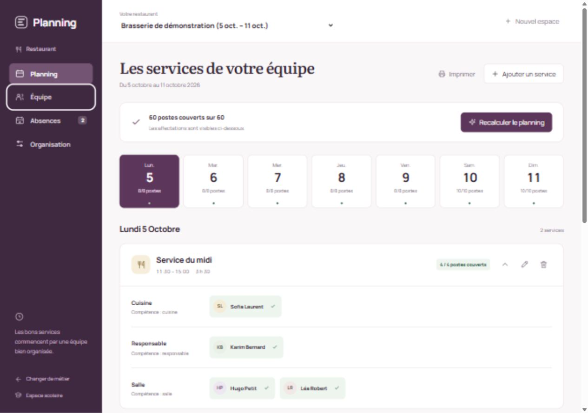
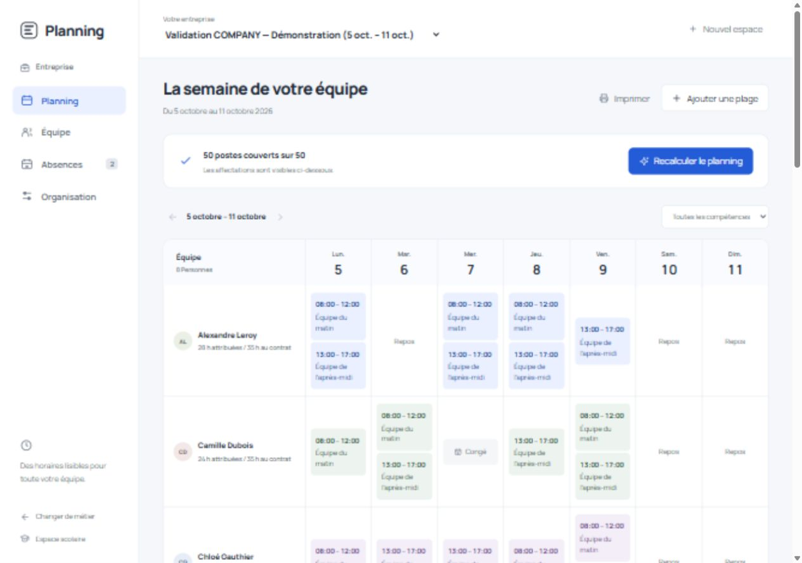
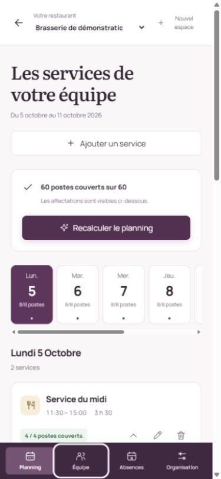

# Planning métier — livraison et validation du 9 octobre 2026

## Conclusion sur le moteur

Le socle est adapté à plusieurs métiers : demandes, postes, ressources, critères
d'éligibilité et plugins de contraintes sont génériques. Un profil métier choisit
son vocabulaire et ses règles ; le domaine ne contient aucun branchement sur le
restaurant ou l'entreprise.

Il fallait néanmoins compléter le temps cyclique par des dates réelles. Les
plugins seuls ne pouvaient pas représenter correctement un congé individuel ou
un service traversant minuit. Cette extension est maintenant implémentée dans le
même moteur, sans supprimer le fonctionnement scolaire.

## Changements livrés

- Restaurant : services datés, rôles et quantités, compétences, couverture,
  affectations et besoins non couverts. Vue quotidienne dédiée.
- Entreprise : plages de travail et besoins, horaires par personne, contrat
  hebdomadaire et absences visibles dans la semaine. Vue dédiée par équipe.
- Formulaires métier persistants : création d'espace vide ou de démonstration,
  employés, indisponibilités récurrentes, services, congés, maladie et autre absence.
- Règles ajoutées : `rest.min`, `work.days_max`, `load.contract`, `fairness.weekend`.
  Les plafonds et minima ventilent les nuits sur les jours et semaines réellement
  travaillés ; une pause n'ajoute pas d'heures au contrat.
- Migration additive V6 : absences, appartenance ressource/scénario et dates des
  affectations. Le jeu scolaire et les migrations V1–V5 sont conservés.
- Interfaces adaptatives, fontes locales, états de chargement et d'erreur,
  animations respectant la préférence de réduction du mouvement.

Les usages et leurs limites détaillées figurent dans
[USE-CASES-metiers.md](USE-CASES-metiers.md).

## Bugs corrigés depuis l'audit V1

| Problème | Correction |
|---|---|
| Fin d'une activité ignorant une pause interne | Fin calculée depuis son dernier créneau réellement occupé. |
| Créneaux qui se chevauchent ou coupure négative | Validation explicite du modèle temporel et de la politique de coupure. |
| Configuration manuelle d'une règle structurelle comptée deux fois | Rejet à la saisie et dans le builder ; réglage par poids uniquement. |
| Minimum de charge ignorant une période vide | Agrégation par ressource et période, même sans affectation. |
| Débordement du calcul d'équilibrage | Calcul en entiers longs et opérations contrôlées. |
| Continuité rejetant une équipe stable de plusieurs personnes | Comparaison des ensembles de ressources par occurrence. |
| Résultat ancien affiché après une modification | Scénario remis en brouillon, affectations et rapport masqués jusqu'au recalcul. |
| Deux calculs simultanés ou modification pendant le calcul | Verrou du scénario et refus de la seconde opération. |
| Créations répétées après un échec de rafraîchissement UI | Conservation de l'identifiant créé et possibilité de reprendre le rafraîchissement. |
| Formulaire local refusé avec l'origine 127.0.0.1 | Origines locales explicites pour les ports du frontend. |
| Service de 30 minutes affecté à une personne absente, à score HARD égal | Priorités métier séparées : poste vacant HARD1, garde-fous HARD1000. Migration V7 des anciennes configurations par défaut ; réglages experts divergents conservés. |

## Vérifications effectuées

- Suite Maven complète : **128 tests, 0 échec, 0 erreur, 0 test ignoré**.
  Elle couvre les plugins, la cohérence score/rapport, dates, nuits, pauses,
  périodes vides et validations de la façade métier.
- Build frontend TypeScript et Vite réussi : 74 modules, paquet JavaScript
  d'environ 288 Ko avant compression et 88 Ko compressé.
- Base PostgreSQL 16 dédiée : migrations V1 à V7 appliquées, historique Flyway
  entièrement réussi. V7 corrige le scénario reproduisant l'absence de 30 min,
  laisse intact un scénario de test avec poids expert personnalisé et remet
  uniquement les résultats concernés en brouillon. Aucune écriture dans le schéma Progression.
- Script HTTP [validate-workforce.ps1](../scripts/validate-workforce.ps1) exécuté
  avec le backend et PostgreSQL réels : restaurant **60/60 postes**, entreprise
  **50/50 postes**, aucune affectation sur les absences, égalité score/rapport.
- Service 22h–2h : première résolution affectée, fin enregistrée le lendemain
  à 2h. Ajout d'une maladie le lendemain : ancien résultat masqué, nouvelle
  résolution avec un poste vacant. Les deux jobs et leurs dates ont été vérifiés
  directement en base.
- Huit tests FULL_ASSERT utilisent les règles réellement créées par la façade :
  absence de 30 min, nuit, conflit, repos, plafond quotidien et hebdomadaire,
  contrat à zéro et sept jours de douze postes. Le dernier laisse douze postes
  vacants et respecte le maximum de jours consécutifs.
- Après V7, le scénario HTTP qui affectait la personne absente laisse son poste
  de 30 min vacant. Le script complet repasse : couverture restaurant et entreprise
  à 100 %, nuit et service court pendant la maladie tous deux vacants.
- Résolution du scénario scolaire existant terminée. Son jeu de démonstration
  peut comporter des violations : cette vérification prouve la conservation du
  parcours, pas la faisabilité de tous ses besoins.
- HTTP : date illisible, nom vide et profil inconnu renvoient 400 ; route inconnue
  renvoie 404 ; calcul concurrent et ajout d'employé pendant un calcul refusés.
  Pré-vérification CORS pour `127.0.0.1:5174` acceptée.
- Navigateur : création persistée d'un employé et d'un congé fictifs ; lancement
  d'un calcul, état occupé puis résultat rafraîchi et message de fin.
- Dernière revue UI : horaires et intitulés de la grille entreprise agrandis,
  focus clair sur le menu restaurant, services repliables avec état accessible.
  Le repli a été vérifié dans le navigateur ; les services restent ouverts par défaut.
  À largeur intermédiaire, les liens du menu réduit conservent un nom accessible
  et une infobulle même lorsque leur texte est masqué.
- Captures restaurant/entreprise avec viewports IAB demandés de 1280×900 et
  390×844 ; fichiers exportés mesurés à 1265×889 et 375×812. Contrôle DOM
  complémentaire à 375×812 : largeur de page 360 px, sans débordement horizontal ;
  les listes de jours disposent de leur propre défilement.

Les champs date sont vérifiés par les tests et l'intégration HTTP. La commande
automatisée de remplissage d'un champ date dans le navigateur a changé sa valeur
visible sans déclencher l'état React ; cette tentative n'est pas comptée comme
une validation du changement de date depuis l'interface.

## Limites restant à traiter

La façade métier couvre actuellement 1 à 28 jours avec un pas de 30 minutes et des
absences par journées entières. Elle ne calcule pas automatiquement le prorata
d'un contrat sur une semaine partielle ou un congé. L'équité ne charge aucun
historique extérieur au scénario. Le temps reste local, sans gestion des fuseaux
ni du changement d'heure ; ces besoins exigent une extension temporelle.

La publication, les affectations verrouillées manuellement, les exports et les
connecteurs restent des évolutions produit. Avant une exploitation en production,
il faut traiter l'authentification, la reprise des jobs en déploiement à plusieurs
instances et la conservation indépendante des plannings historiques lors d'une
suppression de référentiel, points signalés dans l'audit initial. La charge de
plusieurs milliers d'affectations n'a pas été mesurée par cette livraison.

## Captures

## Prévisualisation locale

Les services de démonstration restent disponibles pour la revue : frontend
`http://127.0.0.1:5174`, backend `http://127.0.0.1:8081`, PostgreSQL dédié dans le
conteneur `planning-v2-db` sur le port 5434, base `planning_v2`. Cette base conserve
les espaces et cas de validation créés pendant la livraison.

Pour arrêter la prévisualisation, arrêter ses processus de développement frontend
et backend (ports 5174 et 8081), puis `docker stop planning-v2-db`. Arrêter le
conteneur conserve ses données ; sa suppression n'est pas nécessaire.
